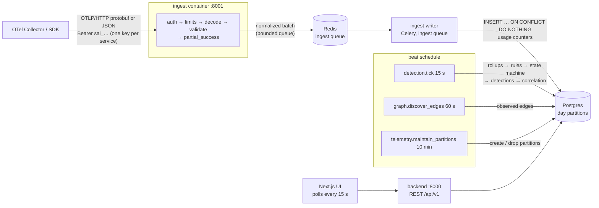

# Incident pipeline: ingestion → detection → correlation (Phase 3)

How telemetry becomes an incident. Decisions and their reasons live in the ADRs:
[0002](../decisions/0002-tenant-isolation.md) (ingest-key lookup exception),
[0005](../decisions/0005-telemetry-storage.md) (partitioned Postgres storage),
[0006](../decisions/0006-detection-and-correlation.md) (rules, state machine, correlation).
Measured numbers for this machine are in [`docs/evidence/phase-3/`](../evidence/phase-3/).

## 1. Ingestion (`app/api/otlp.py`, `app/ingest/`, process `app.ingest_main`)

A separate process and container (`ingest`, 384 MiB limit) so a flood cannot starve the API.
Each request goes through, in order:

| Step | Limit (default) | Refusal |
|---|---|---|
| body size | 4 MiB | 413 |
| key auth (`sai_<prefix>_<secret>`, SHA-256 lookup, 10 s cache) | revoked key / archived service | 401 |
| per-key request rate | 50 requests/s | 429 + `Retry-After` |
| decode (protobuf or JSON, gzip or identity) | gunzip capped at 16 MiB | 400 malformed, 413, 415 |
| records per request | 10,000 | 413 |
| per-key record rate | 20,000 records/s | 429 + `Retry-After` |
| per-record validation | ids, timestamps (now − 2 h … now + 5 min), names, kinds, values, `service.name` = the key's service | dropped and counted → `partial_success` |
| enqueue | 100 pending batches, 2 MiB per batch | 503 + `Retry-After: 5` |

Org and service always come from the key, never from the payload. Attributes are bounded (32 keys,
256 chars) and secret-looking keys are redacted before anything is stored. Every outcome is counted
in Prometheus (`ingest_requests_total`, `ingest_records_total{outcome,reason}`) and, by the writer,
per key and minute in `ingest_usage` (`GET /services/{id}/ingest-usage`).

## 2. Writer (`app/services/ingest_writer.py`, container `ingest-writer`)

One transaction per batch: claim the `batch_id` in `ingest_batches` (a redelivered message is a
no-op), insert spans / logs / metric points / deployments with `ON CONFLICT DO NOTHING` on dedup
primary keys (a re-sent record is never duplicated), enforce 2,000 metric series per service,
upsert usage counters, touch `last_seen_at`. Failures retry with exponential backoff and ±50 %
jitter (≤ 5 retries), then go to a capped Redis dead-letter list.

## 3. Storage

Day-partitioned `spans`, `log_records`, `metric_points` (retention 3 / 3 / 7 days by default; this
Codespace runs 1 day for disk). Partitions for today − 1 … today + 2 are created ahead; old days are
dropped whole. ADR 0005 records why Postgres now and ClickHouse/Loki later.

## 4. Dependency graph (`app/services/service_graph.py`)

Declared edges are written with `PUT /services/{id}/dependencies`. Observed edges come every 60 s
from the last 2 minutes of spans: a server span whose parent belongs to another service of the same
project, and database client spans (`<db.system>:<db.namespace>`). Every edge must cite its evidence
(DB `CHECK`): the declared dependency row, or a sample trace id.

## 5. Detection (`app/services/detection.py`, pure rules in `app/detection/`)

Every 15 s, evaluated as of now − 30 s on the 15-s grid, under an advisory lock in one transaction:
rollups per service (`service_window_stats`), five deterministic rules (error rate, latency shift
vs a 30-min median baseline, resource saturation, health check, deploy change), a per-detector
state machine with minimum durations and hysteresis, and detections with templated explanations
built only from stored numbers. Retried ticks change nothing (`last_evaluated_at`, unique
`(org, service, rule, started_at)`).

## 6. Correlation (`app/services/correlation.py`)

At the end of each tick, each new detection joins the best-scoring active incident of its project
that shares a **structural** reason — shared trace (3), exception signature (3), dependency edge
(2), deploy proximity (2), same service (1) — or opens a new incident. Time proximity alone never
merges. Reasons and score are stored per link and shown in the UI as "grouped because". Incidents
keep a timeline (`incident_events`, monotonic ids for Phase 4's SSE replay). The system never
resolves an incident; it records `all_detections_resolved` and leaves the status to people.

## 7. API and UI

Read endpoints (viewer): incidents (filters, title/`#number` search, cursor), incident detail and
events, detections, detector states, service graph, overview, per-service ingest usage. Commands:
incident transitions (engineer), services and dependencies (engineer), keys and archive (admin).
Every `/orgs/{org_id}/…` route is covered by the OpenAPI-driven isolation test (non-member → 404).

The UI ([frontend.md](frontend.md)) polls these endpoints every 15 s; SSE replaces polling in
Phase 4.
