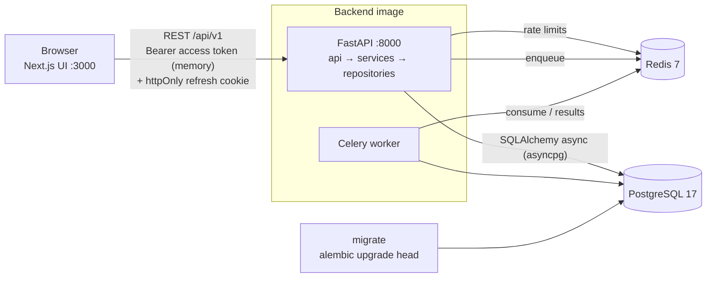

# Architecture overview (as of Phase 1)

SentinelAI is a **modular monolith**: one FastAPI application with internal modules, plus a Celery
worker process built from the same code. PostgreSQL is the system of record; Redis is the Celery
broker/result backend and the rate-limit store. The Next.js frontend talks to the API over REST.

## Backend layers

| Layer | Package | Rule |
|---|---|---|
| API | `app/api` | Thin routes: parse, call a service, map the result. Dependencies resolve the user, the tenant context (`require_org_role`), settings, the rate limiter. |
| Services | `app/services` | Business logic and transactions (each use case commits once). May not import SQL builders — enforced by `tests/unit/test_architecture.py`. |
| Repositories | `app/repositories` | All queries. Tenant-owned models only through `TenantRepository` (filters every query by `org_id`). |
| Models / DB | `app/models`, `app/db` | SQLAlchemy 2.0 models, deterministic constraint names, Alembic migrations in `backend/migrations`. |
| Core | `app/core` | Settings, JSON logging + request ids, errors, security primitives, rate limiting, pagination, metrics. |

## Request lifecycle

1. `RequestContextMiddleware` (pure ASGI, outermost) accepts or generates `X-Request-ID`, binds it
   to the log context, adds security headers, times the request, records Prometheus metrics, and
   converts any unhandled exception into the uniform 500 body.
2. CORS (allow-listed origins, credentials allowed).
3. The route's dependencies authenticate (`Authorization: Bearer`), then for `/orgs/{org_id}/…`
   check membership and role → `TenantContext`.
4. The service runs against tenant-scoped repositories and commits.
5. Errors anywhere become `{"error": {"code", "message", "request_id", "details"?}}`.

Every log line is one JSON object with `request_id`; secrets are redacted by key.

## Tenancy and authorization

- Organizations are tenants; users join them through `organization_members` with a role
  (`owner > admin > engineer > viewer`). Roles are read from the database on every request.
- Non-member → **404** (no existence leak); insufficient role → **403**. Details: ADR 0002.
- Policy: viewers read; engineers create/update projects; admins delete projects, manage
  engineer/viewer members and read the audit log; owners manage everything. An org always keeps an
  owner.

## Authentication

Short-lived JWT access token (15 min, HS256) held in browser memory + rotating opaque refresh token
in an httpOnly `SameSite=Strict` cookie scoped to `/api/v1/auth`, stored as a SHA-256 hash, with
reuse detection that revokes the whole login family. Argon2id passwords. Redis rate limits on auth
routes, failing closed. Details: ADR 0001.

## Data model (Phase 1)

`users`, `organizations`, `organization_members`, `projects`, `refresh_tokens`, `audit_logs`.
Phase 3 adds the service registry: `services` (per project; `name` = OTel `service.name`),
`service_dependencies` (declared edges) and `service_api_keys` (per-service ingest keys, SHA-256 at
rest). Projects and services are archived, never hard-deleted; archiving revokes ingest keys.
Telemetry is stored in day-partitioned Postgres tables (`spans`, `log_records`, `metric_points`)
with dedup primary keys and runtime-managed partitions/retention; a `beat` container schedules the
maintenance job. Details and trade-offs: ADR 0005.
Tenant-owned rows carry `org_id`; `projects` has `UNIQUE (org_id, id)` so later tables can use
composite foreign keys that cannot cross tenants. The plan (`docs/plans/phase-1.md` §2.3) lists the
tables expected in later phases.

## Audit

Auth events (register, login success/failure, refresh, reuse detection, logout) and org events
(org created/updated, member added/role changed/removed/left, project created/updated/deleted) are
written to `audit_logs` in the same transaction as the action. Failed logins and reuse detection
commit their audit row before the error is returned. Metadata is redacted; no passwords or tokens.

## Operations

| Endpoint | Purpose |
|---|---|
| `GET /health` | Liveness; no dependency calls. Used by the container healthcheck. |
| `GET /ready` | Postgres `SELECT 1` and Redis `PING` concurrently (2 s each); 200 or 503 with per-dependency status and the error class only. |
| `GET /metrics` | Prometheus: `http_requests_total`, `http_request_duration_seconds`, `auth_events_total`. |

Compose healthchecks: `pg_isready`, `redis-cli ping`, `/health`, `celery inspect ping`, frontend
`/healthz`. Services start in dependency order (`service_healthy`, `service_completed_successfully`
for the migration job).

## Testing strategy

- Backend unit tests need no services; integration tests use real Postgres (a separate
  `sentinel_test` database, migrated per session, truncated after each test) and real Redis (db 15).
- Isolation guards: every org-scoped endpoint in the OpenAPI schema is called as a non-member and
  must return 404; every tenant model must have a `TenantRepository`.
- Frontend: Vitest + Testing Library for components and the auth client; Playwright for the full
  browser flow against the running stack.
- CI (`.github/workflows/ci.yml`) runs all of the above, including a compose-based e2e job.
