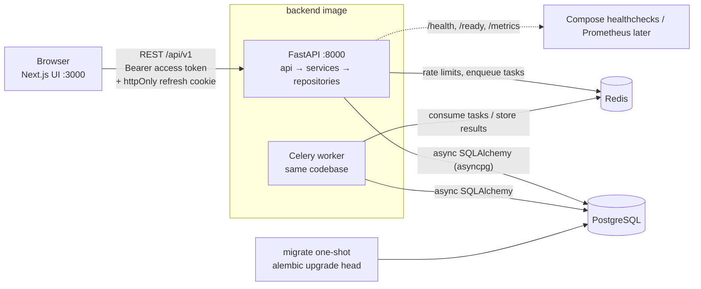

# Phase 1 — Foundation (plan)

Status: **APPROVED 2026-11-17** (user: "do what you recommend" — incl. installing uv).

Scope: repo, Compose, FastAPI, Next.js, auth + orgs + RBAC, migrations, health/readiness, CI.
Out of scope: anything from Phase 2+ (testbed app, OTLP ingestion, incidents, LangGraph, LLM provider, sandbox). The `backend/app/llm/` package is **not** created in this phase.

---

## 0. Environment findings (Step 1, 2026-11-17)

| Item | Finding | Impact |
|---|---|---|
| Working dir `C:\SentineAI` | Only `CLAUDE.md`. Not a git repo. | Greenfield; `git init` in T1. Nothing to overwrite. |
| Docker / Compose (Windows) | **Not installed** on Windows PATH. No Docker Desktop. | — |
| Docker / Compose (WSL2 Ubuntu) | Docker Engine **29.8.2**, Compose **v5.6.0**, daemon `active`. User `vit23bit0042` is **not in the `docker` group** → `permission denied` on `/var/run/docker.sock`. | **Blocker for T2+ verification.** Needs one `sudo` command from you (see §9). |
| WSL memory | ~3 GB visible to WSL (7.7 GB host). | Tight for a Next.js production build in Docker. Optional `.wslconfig` bump (see §9). |
| Node / npm | v22.22.2 / 10.9.7 | OK. Use npm (no pnpm — avoids another tool). |
| Python (Windows) | 3.13.1 and 3.11 via `py`; **no 3.12**. `uv` not installed. | Stack mandates 3.12. Plan: install `uv` (winget) and let it provision 3.12 for the local venv. Containers use `python:3.12-slim`. |
| Python (WSL) | 3.12.3 | Fallback if you prefer not to install uv on Windows. |
| git | 2.45.1, global identity configured, `core.autocrlf` unset | Add `.gitattributes` (`eol=lf`) so shell/Docker files built in Linux aren't CRLF-broken. |
| Ports 3000/8000/5432/6379 | Free on Windows and in WSL | OK. WSL2 localhost forwarding makes `curl localhost:8000` from Windows reach containers. |

**Run modes (assumption):**
- **Stack mode** — `docker compose up --build` inside WSL against `/mnt/c/SentineAI`; production-like images, no bind mounts (bind-mount file watching over `/mnt/c` is unreliable). This is what the acceptance criteria are proven against.
- **Dev/test mode** — Postgres + Redis from Compose; backend via `uv run` and frontend via `npm run dev` on Windows for fast iteration and for running the test suites.

---

## 1. Architecture overview

Modular monolith (one FastAPI app, internal modules) + separate Celery worker process sharing the same codebase. Postgres is the system of record; Redis is the Celery broker/result backend and the rate-limit store.



### Backend modules (Phase 1)

| Module | Responsibility |
|---|---|
| `app/core/config.py` | `pydantic-settings` `Settings`; secrets as `SecretStr`; fail-fast validation (e.g. JWT secret ≥ 32 bytes; `COOKIE_SECURE` required true when `ENV=prod`). |
| `app/core/logging.py`, `request_context.py` | JSON logs to stdout (structlog). Request-ID middleware (accept validated `X-Request-ID` or generate UUID), bound into a contextvar, echoed in response header and every error body. Redaction processor for keys matching `password|token|secret|authorization|cookie`. |
| `app/core/errors.py` | `AppError` hierarchy + centralized handlers → uniform error shape (§3.1). Unhandled exceptions → 500 with request_id, stack only in logs. |
| `app/core/security/` | `passwords.py` (argon2id, run in threadpool, rehash-on-login), `tokens.py` (JWT encode/verify, refresh token generation + SHA-256 hashing). |
| `app/core/rate_limit.py` | Redis fixed-window limiter (INCR + EXPIRE, Lua-atomic). Fails **closed** (503) if Redis is down — safest default for auth. |
| `app/core/metrics.py` | `prometheus-client`: `http_requests_total`, `http_request_duration_seconds`, `auth_events_total`; exposed at `/metrics`. |
| `app/db/` | Declarative base, naming convention for constraints, async engine/session factory with pooling. |
| `app/models/` | ORM models (§2). |
| `app/repositories/` | `Repository[T]` and **`TenantRepository[T]`** — the single place tenant filtering happens (§2.2). |
| `app/services/` | Business logic: `auth`, `orgs`, `members`, `projects`, `audit`, `health`. |
| `app/api/` | Thin routers + dependencies: `get_session`, `get_current_user`, `require_org_role(min_role)` → `TenantContext`. |
| `app/schemas/` | Pydantic v2 request/response models, `ErrorResponse`, `Page[T]`. |
| `app/worker/` | Celery app + `system.ping` placeholder task. |

### Frontend modules

| Module | Responsibility |
|---|---|
| `src/lib/api/schema.d.ts` | Generated from backend OpenAPI by `openapi-typescript` (CI fails if stale). |
| `src/lib/api/client.ts` | `openapi-fetch` client typed from the schema; injects Bearer token; on 401 performs **single-flight** refresh then retries once; normalizes the error shape. |
| `src/lib/auth/` | Auth context: access token held **in memory only**; bootstraps via `POST /auth/refresh` on load; logout clears state. |
| `src/app/(auth)/login`, `register` | Forms (shadcn Form = react-hook-form + zod). |
| `src/app/(app)/layout.tsx` | Authenticated shell, responsive sidebar (collapsible; sheet on mobile), org switcher, user menu/logout. |
| `src/app/(app)/orgs/[orgId]/projects` | List (TanStack Query, cursor pagination "Load more") + create dialog; loading / error / empty states. |
| `src/app/healthz/route.ts` | Container healthcheck endpoint. |

---

## 2. Database schema (Phase 1)

Conventions: PKs `uuid` default `gen_random_uuid()` (except `audit_logs`, `bigint identity`); all timestamps `timestamptz` default `now()`; enum-like columns are `varchar` + `CHECK` (no PG enum types → cheaper migrations); constraint names via SQLAlchemy naming convention. Postgres image: `postgres:17-alpine`.

### 2.1 Tables

**`users`** (global, not tenant-owned)
| column | type | notes |
|---|---|---|
| id | uuid PK | |
| email | varchar(320) NOT NULL | normalized lowercase in service; `CHECK (email = lower(email))`; **UNIQUE** |
| password_hash | text NOT NULL | argon2id PHC string |
| display_name | varchar(100) NOT NULL | |
| is_active | boolean NOT NULL default true | checked on every authenticated request |
| last_login_at | timestamptz NULL | |
| created_at / updated_at | timestamptz NOT NULL | |

**`organizations`** (the tenant root)
| column | type | notes |
|---|---|---|
| id | uuid PK | |
| name | varchar(100) NOT NULL | |
| slug | varchar(63) NOT NULL **UNIQUE** | `CHECK (slug ~ '^[a-z0-9](?:[a-z0-9-]{0,61}[a-z0-9])?$')` |
| created_at / updated_at | timestamptz | |

**`organization_members`**
| column | type | notes |
|---|---|---|
| org_id | uuid FK → organizations ON DELETE CASCADE | |
| user_id | uuid FK → users ON DELETE CASCADE | |
| role | varchar(16) NOT NULL | `CHECK (role IN ('owner','admin','engineer','viewer'))` |
| created_at / updated_at | timestamptz | |
| | | **PK (org_id, user_id)**; index `(user_id)` for "my orgs" |

"At least one owner per org" is enforced in the service layer inside a transaction with `SELECT … FOR UPDATE` on the org's owner rows.

**`projects`** (tenant-owned)
| column | type | notes |
|---|---|---|
| id | uuid PK | |
| org_id | uuid NOT NULL FK → organizations ON DELETE CASCADE | |
| name | varchar(100) NOT NULL | |
| slug | varchar(63) NOT NULL | same CHECK as org slug |
| description | varchar(2000) NULL | |
| created_by | uuid NULL FK → users ON DELETE SET NULL | |
| created_at / updated_at | timestamptz | |
| | | **UNIQUE (org_id, slug)**; **UNIQUE (org_id, id)** (target for future composite FKs); index `(org_id, created_at DESC, id DESC)` for keyset pagination |

**`refresh_tokens`**
| column | type | notes |
|---|---|---|
| id | uuid PK | |
| user_id | uuid NOT NULL FK → users ON DELETE CASCADE | |
| family_id | uuid NOT NULL | one family per login; rotation keeps family |
| token_hash | bytea NOT NULL **UNIQUE** | SHA-256 of the 256-bit random token; raw token never stored |
| expires_at | timestamptz NOT NULL | 14 days absolute per token |
| family_expires_at | timestamptz NOT NULL | 30-day hard cap on a login session |
| used_at | timestamptz NULL | set when rotated |
| revoked_at | timestamptz NULL | |
| revoked_reason | varchar(32) NULL | `CHECK IN ('logout','reuse_detected','rotated','admin')` |
| replaced_by_id | uuid NULL FK → refresh_tokens | |
| user_agent | varchar(512) NULL | for audit/session listing later |
| ip | inet NULL | |
| created_at | timestamptz | |
| | | indexes `(user_id)`, `(family_id)`, `(expires_at)` (for cleanup job) |

**`audit_logs`** (append-only; tenant-owned when `org_id` set)
| column | type | notes |
|---|---|---|
| id | bigint identity PK | |
| org_id | uuid NULL FK → organizations ON DELETE CASCADE | NULL for user-level events (login, refresh, logout) |
| actor_user_id | uuid NULL FK → users ON DELETE SET NULL | NULL for anonymous (failed login on unknown email) |
| action | varchar(64) NOT NULL | e.g. `auth.login.succeeded`, `auth.login.failed`, `auth.refresh.reuse_detected`, `org.created`, `org.member.added`, `org.member.role_changed`, `project.created`, `project.deleted` |
| target_type | varchar(32) NULL | |
| target_id | varchar(64) NULL | |
| ip | inet NULL | |
| user_agent | varchar(512) NULL | |
| request_id | varchar(128) NULL | correlates with logs |
| metadata | jsonb NOT NULL default '{}' | never contains secrets/passwords (redaction tested) |
| created_at | timestamptz | |
| | | indexes `(org_id, created_at DESC, id DESC)`, `(actor_user_id, created_at DESC)` |

The repository exposes insert + scoped read only; no update/delete paths. Partitioning by month is deferred (low volume in Phase 1; revisit with the telemetry partitioning ADR in Phase 3).

### 2.2 Tenant strategy (`org_id`)

- Every tenant-owned table has `org_id uuid NOT NULL` (even when a parent like `project_id` exists later) so filtering is uniform and indexable.
- **One enforcement point:** `TenantRepository[T]` is constructed with a `TenantContext(org_id, user_id, role)` that only the `require_org_role` dependency can produce. Every `select/update/delete` it builds adds `WHERE model.org_id = :org_id`; `create` stamps `org_id` from context and ignores any client-supplied value. Routes and services never filter by org themselves.
- **Membership gate:** `require_org_role(min_role)` loads `organization_members` for `(path org_id, current user)`. Not a member → **404 `org_not_found`** (no existence leak). Member with insufficient role → **403 `forbidden`**.
- Object lookups by ID in another org → **404** because the scoped query finds nothing.
- Future child tables reference parents via composite FK `(org_id, project_id) → projects(org_id, id)` so a row can never point across tenants.
- **Guard tests:** (a) a test walks the FastAPI route table and asserts every `/orgs/{org_id}/…` route returns 404 to a non-member; (b) a test asserts every ORM model with an `org_id` column is accessed only through a `TenantRepository` subclass.
- Postgres Row-Level Security is a possible defense-in-depth layer; **deferred** (ADR 0002 records why: app-layer scoping is testable now; RLS adds connection-level session state that complicates pooling/Celery).

### 2.3 Later tables (names only — schema leaves room for them)

`invitations`, `api_keys` / `ingest_tokens`, `services`, `service_dependencies`, `ingestion_batches`, `telemetry_spans`*, `telemetry_logs`*, `telemetry_metric_points`* (*time-partitioned), `detection_rules`, `signals` (anomalies), `incidents`, `incident_signals`, `incident_events`, `investigations`, `investigation_events` (SSE, monotonic id), `investigation_steps`, `evidence`, `hypotheses`, `findings`, `finding_evidence`, `reports`, LangGraph checkpoint tables (library-managed), `code_repositories`, `reproduction_runs`, `sandbox_runs`, `patches`, `fix_proposals`, `approvals`, `pull_requests`, `llm_calls` (tokens/latency/cost), `fault_injections` + `ground_truth_records` (testbed), `eval_runs`, `eval_results`.

All of these are tenant-owned (`org_id`) and most are project-scoped (`project_id` with composite FK), except the testbed/eval tables which reference an org/project they were run against.

---

## 3. API contracts (Phase 1)

Base path `/api/v1` (health/ready/metrics at root). JSON only. OpenAPI at `/docs` and `/openapi.json` (docs disabled when `ENV=prod`).

### 3.1 Error shape (every non-2xx)

```json
{
  "error": {
    "code": "validation_error",
    "message": "Request validation failed.",
    "request_id": "6f1c…",
    "details": [{"loc": ["body", "email"], "msg": "value is not a valid email address", "type": "value_error"}]
  }
}
```
`code` values: `validation_error` (422), `invalid_credentials` (401), `not_authenticated` (401), `token_expired` (401), `refresh_token_invalid` (401), `forbidden` (403), `not_found` / `org_not_found` / `project_not_found` (404), `conflict` / `email_taken` / `slug_taken` (409), `last_owner` (409), `rate_limited` (429, with `Retry-After`), `dependency_unavailable` (503), `internal_error` (500). `details` is present only for validation errors.

### 3.2 Pagination (every list endpoint)
Query: `limit` (1–100, default 50), `cursor` (opaque). Response: `{"items": [...], "next_cursor": "…" | null}`. Cursor = base64url(JSON `{created_at, id}`), keyset on `(created_at DESC, id DESC)`; malformed cursor → 422.

### 3.3 Auth

| Method & path | Auth | Request | Response |
|---|---|---|---|
| `POST /auth/register` | none, rate-limited | `{email, password (12–128), display_name (1–100), org_name (1–100)}` | **201** `{user, organization, membership_role:"owner", access_token, token_type:"bearer", expires_in}` + `Set-Cookie: sentinel_refresh` · 409 `email_taken` · 422 |
| `POST /auth/login` | none, rate-limited (per IP + per email) | `{email, password}` | **200** `{user, access_token, token_type, expires_in}` + refresh cookie · 401 `invalid_credentials` (same response and comparable timing for unknown email vs wrong password — dummy hash verified) · 429 |
| `POST /auth/refresh` | refresh cookie + `Origin` allow-listed | — | **200** `{access_token, token_type, expires_in}` + rotated cookie · 401 `refresh_token_invalid`. Presenting an already-rotated token → **revoke whole family**, audit `auth.refresh.reuse_detected`, 401. |
| `POST /auth/logout` | refresh cookie (idempotent) | — | **204**, family revoked, cookie cleared |
| `GET /auth/me` | Bearer | — | **200** `{user, memberships: [{org_id, org_name, org_slug, role}]}` |

`user` = `{id, email, display_name, created_at}`. Cookie: `sentinel_refresh`, `HttpOnly`, `SameSite=Strict`, `Path=/api/v1/auth`, `Secure` from config (true in prod), `Max-Age` = token TTL.

### 3.4 Organizations & members

Role order: `viewer < engineer < admin < owner`.

| Method & path | Min role | Request → Response |
|---|---|---|
| `GET /orgs` | authenticated | → `Page[{id, name, slug, role, created_at}]` (orgs I belong to) |
| `POST /orgs` | authenticated | `{name, slug?}` → **201** org; caller becomes `owner` · 409 `slug_taken` |
| `GET /orgs/{org_id}` | viewer | → org |
| `PATCH /orgs/{org_id}` | admin | `{name?}` → org |
| `GET /orgs/{org_id}/members` | viewer | → `Page[{user_id, email, display_name, role, created_at}]` |
| `POST /orgs/{org_id}/members` | admin | `{email, role}` → **201** member · 404 `user_not_found` (adds an *existing* user; email invitations are a later feature) · 409 already member |
| `PATCH /orgs/{org_id}/members/{user_id}` | admin | `{role}` → member |
| `DELETE /orgs/{org_id}/members/{user_id}` | admin, or self (leave) | **204** |
| `GET /orgs/{org_id}/audit-logs` | admin | → `Page[audit entry]` |

Role-assignment rules: only an **owner** can grant/revoke `owner` or `admin`; an admin can manage `engineer`/`viewer` only; the last owner cannot be demoted or removed (409 `last_owner`).

### 3.5 Projects

| Method & path | Min role | Request → Response |
|---|---|---|
| `GET /orgs/{org_id}/projects` | viewer | → `Page[project]` |
| `POST /orgs/{org_id}/projects` | engineer | `{name, slug?, description?}` → **201** project · 409 `slug_taken` |
| `GET /orgs/{org_id}/projects/{project_id}` | viewer | → project · 404 |
| `PATCH /orgs/{org_id}/projects/{project_id}` | engineer | `{name?, description?}` → project |
| `DELETE /orgs/{org_id}/projects/{project_id}` | admin | **204** (hard delete — no child data exists in Phase 1; Phase 3 will switch to archive before projects own incidents) |

`project` = `{id, org_id, name, slug, description, created_by, created_at, updated_at}`. Slug auto-derived from name when omitted.

### 3.6 Health

| Path | Behavior |
|---|---|
| `GET /health` | Liveness, no dependency calls → **200** `{"status":"ok"}` |
| `GET /ready` | Checks Postgres (`SELECT 1`) and Redis (`PING`) concurrently, 2 s timeout each → **200** `{"status":"ready","checks":{"postgres":{"status":"ok","latency_ms":3.1},"redis":{"status":"ok","latency_ms":0.8}}}` or **503** `{"status":"degraded","checks":{…,"redis":{"status":"error","error":"ConnectionError"}}}` (error *class* only — never messages that could carry DSNs). |
| `GET /metrics` | Prometheus exposition. |

---

## 4. Auth decision (summary — full text in `docs/decisions/0001-auth.md`)

**JWT access token (15 min, HS256) sent as `Authorization: Bearer`, held in browser memory + opaque rotating refresh token (httpOnly cookie, SHA-256-hashed in Postgres, family-based reuse detection).** Roles are *not* embedded in the JWT; membership/role and `is_active` are resolved per request so role changes and deactivation take effect immediately. Rejected alternative: server sessions in a cookie — simpler for a pure browser app, but SentinelAI will also be called by non-browser clients (CLI, CI, testbed scripts), and cookie auth on every mutating route requires CSRF protection everywhere; here only `/auth/refresh` and `/auth/logout` use a cookie and they are protected by `SameSite=Strict` + Origin allow-list. Known trade-off: a stolen access token stays valid ≤ 15 min after logout.

---

## 5. Dependencies (each with reason)

**Backend runtime:** `fastapi` + `uvicorn[standard]` (stack), `pydantic` v2 + `pydantic-settings` (stack; typed env config), `sqlalchemy[asyncio]` 2.0 + `asyncpg` (stack; async driver, also used by Alembic → single driver), `alembic` (stack), `argon2-cffi` (argon2id hashing; no stdlib equivalent), `pyjwt` (small, well-maintained JWT; pinned `algorithms`), `redis` (asyncio client for readiness + rate limiting), `celery[redis]` (stack), `structlog` (contextvar binding + redaction processors for JSON logs), `prometheus-client` (metrics endpoint the testbed Prometheus will scrape), `email-validator` (Pydantic `EmailStr`).
**Backend dev:** `pytest`, `pytest-asyncio`, `httpx` (ASGI test client), `ruff`, `mypy`, `asgi-lifespan` (run lifespan in tests).
**Tooling:** `uv` (Python 3.12 provisioning + lockfile).
**Frontend runtime:** `next`, `react`, `react-dom`, `tailwindcss`, shadcn/ui (+ its `radix-ui`, `class-variance-authority`, `clsx`, `tailwind-merge`, `lucide-react`), `@tanstack/react-query` (stack), `openapi-fetch` (typed client from generated schema, ~6 kB), `react-hook-form` + `zod` + `@hookform/resolvers` (shadcn Form pattern; client validation).
**Frontend dev:** `typescript`, `eslint` + `eslint-config-next`, `openapi-typescript` (generate types from OpenAPI; prevents drift), `vitest` + `@testing-library/react` + `@testing-library/user-event` + `jsdom` (component tests), `@playwright/test` (the end-to-end browser acceptance flow).
Recharts is **not** added in Phase 1 (no charts yet). Exact versions are pinned by `uv.lock` / `package-lock.json` at implementation time.

---

## 6. Task list

Work happens on branch `phase-1-foundation` (after an initial commit on `main`); conventional commits after each green task. Each task ends with: format → lint → typecheck → tests → build, real output shown.

### T1 — Repo skeleton
- **Objective:** monorepo layout, hygiene files, git.
- **Files:** `.gitignore`, `.gitattributes` (`* text=auto eol=lf`), `.env.example`, `README.md` (stub), `frontend/` `backend/` `testbed/README.md` (Phase 2 placeholder) `infrastructure/postgres/init/` `docs/{architecture,decisions,plans}/` `.github/workflows/`, `docs/PROGRESS.md`.
- **Tests:** n/a. **AC:** `git status` clean after commit; `.env` ignored (`git check-ignore .env`).

### T2 — Backend core (app factory, config, logging, errors, DB, Alembic baseline)
- **Objective:** runnable FastAPI app with settings, JSON logs with request IDs, centralized error handling, async DB session, Alembic configured (async env) with a baseline empty revision; `uv` project with ruff/mypy strict config.
- **Files:** `backend/pyproject.toml`, `uv.lock`, `alembic.ini`, `alembic/env.py`, `app/main.py`, `app/core/{config,logging,request_context,errors,metrics}.py`, `app/db/{base,session}.py`, `app/schemas/common.py`, `app/api/health.py` (`/health` only here), `tests/conftest.py`, `tests/unit/test_errors.py`, `tests/unit/test_config.py`, `tests/unit/test_logging.py`.
- **Tests:** error handler returns uniform shape + request_id for 404/422/500; request ID echoed/generated, invalid inbound IDs replaced; config rejects short JWT secret; logger redacts secrets.
- **AC:** `ruff check`, `ruff format --check`, `mypy --strict app`, `pytest` green; `uvicorn` starts and `/health` → 200.

### T3 — Docker Compose stack
- **Objective:** `postgres`, `redis`, `migrate` (one-shot `alembic upgrade head`), `backend`, `worker`, `frontend` (minimal Next.js placeholder until T7) with healthchecks, named volumes, `depends_on: condition: service_healthy` / `service_completed_successfully`; ports bound to `127.0.0.1`; non-root images; Redis password.
- **Files:** `docker-compose.yml`, `backend/Dockerfile` (multi-stage, uv), `backend/.dockerignore`, `frontend/Dockerfile` (Next `output: "standalone"`), `infrastructure/postgres/init/01-test-db.sql` (creates `sentinel_test`), `app/worker/{celery_app,tasks}.py` (`system.ping`).
- **Healthchecks:** postgres `pg_isready`; redis `redis-cli -a … ping`; backend `GET /health`; worker `celery inspect ping -d celery@$HOSTNAME`; frontend `GET /healthz`.
- **Tests:** Celery round-trip integration test (in-process worker, real Redis) — added here.
- **AC:** from a clean state (`docker compose down -v`), `docker compose up --build -d` → `docker compose ps` shows every long-running service `healthy`, `migrate` exited 0.

### T4 — Data model + migration
- **Objective:** models for users, organizations, organization_members, projects, refresh_tokens, audit_logs; Alembic revision `0001_phase1_schema`.
- **Files:** `app/models/*.py`, `alembic/versions/0001_*.py`, `tests/integration/test_migrations.py`.
- **Tests:** upgrade head on empty DB → downgrade base → upgrade head again; `alembic check` reports no drift between models and migrations; constraint tests (lowercase email CHECK, slug CHECK, unique (org_id, slug)).
- **AC:** commands above succeed with real output; `\d+` of each table matches §2.

### T5 — Auth (hashing, tokens, register/login/refresh/logout/me, rate limiting, audit)
- **Objective:** §3.3 end-to-end.
- **Files:** `app/core/security/{passwords,tokens}.py`, `app/core/rate_limit.py`, `app/repositories/{base,users,refresh_tokens,audit_logs}.py`, `app/services/{auth,audit}.py`, `app/schemas/auth.py`, `app/api/deps.py`, `app/api/v1/{router,auth}.py`.
- **Tests — unit:** argon2 hash/verify/needs-rehash; JWT encode/verify, expired, wrong alg (`none`/RS256), wrong aud/iss, tampered; refresh token hashing; rate-limiter window logic (fake clock). **Integration (real PG + Redis):** register → login → refresh (rotation, old token rejected) → reuse detection revokes family → logout (subsequent refresh 401); duplicate email 409 (incl. case variance); login rate limit returns 429 + `Retry-After`; rate limiter fails closed when Redis unavailable; audit rows written for each auth event with no secrets in `metadata`; deactivated user's access token rejected.
- **AC:** all green; mypy strict clean.

### T6 — Orgs, members, RBAC, tenant isolation, projects, audit API
- **Objective:** §3.4, §3.5 with `TenantRepository` + `require_org_role`.
- **Files:** `app/repositories/{orgs,memberships,projects}.py`, `app/services/{orgs,members,projects}.py`, `app/schemas/{orgs,projects,audit}.py`, `app/api/v1/{orgs,members,projects,audit_logs}.py`, `docs/decisions/0002-tenant-isolation.md`.
- **Tests — unit:** role ordering and `require_org_role` decisions; role-assignment rules matrix; cursor encode/decode. **Integration:** project CRUD + pagination; RBAC matrix (viewer can't create, engineer can't delete, admin can't grant owner, last-owner protection); **cross-org isolation:** user B → org A's org/members/projects/audit-logs/project-by-id (GET/PATCH/DELETE) all **404**; user B using *their own* org path with org A's project id → 404; B's list never contains A's rows; route-table guard test; repository guard test.
- **AC:** all green; `EXPLAIN` for project list and membership lookup shows index usage (output in self-review notes).

### T7 — Readiness
- **Objective:** `/ready` per §3.6 (+ `/metrics`).
- **Files:** `app/services/health.py`, `app/api/health.py`, `tests/integration/test_health.py`.
- **Tests:** ready=200 with both up; 503 + per-dependency detail when Redis is unreachable (pointed at a closed port) and when Postgres is unreachable.
- **AC:** with the stack running: `curl /health` 200, `/ready` 200; `docker compose stop redis` → `/ready` 503 with `redis.status=error`; `start redis` → 200 again.

### T8 — Frontend
- **Objective:** Next.js (App Router, TS strict, Tailwind, shadcn/ui, TanStack Query) with login/register, authenticated shell with responsive sidebar + org switcher, projects list/create wired to the real API with loading/error/empty states.
- **Files:** `frontend/package.json`, `next.config.ts`, `tsconfig.json`, `eslint.config.mjs`, `vitest.config.ts`, `src/lib/api/{client.ts,schema.d.ts}`, `src/lib/auth/*`, `src/app/(auth)/{login,register}/page.tsx`, `src/app/(app)/layout.tsx`, `src/app/(app)/orgs/[orgId]/projects/page.tsx`, `src/components/{app-sidebar,projects/*}.tsx`, `src/components/ui/*` (shadcn), `src/app/healthz/route.ts`, `backend/scripts/export_openapi.py`.
- **Tests:** Vitest — `ProjectsList` renders loading, error (with retry), empty, populated states; `LoginForm` client validation + server error display; API client single-flight refresh. Playwright (`frontend/e2e/golden-path.spec.ts`) — register user A → create project → listed → logout → login again → register user B (other org) → A's project not visible, and direct URL to A's org shows not-found.
- **AC:** `npm run lint`, `npm run typecheck`, `npm run test`, `npm run build` pass; Playwright passes against the Compose stack.

### T9 — CI
- **Objective:** `.github/workflows/ci.yml` with jobs: **backend** (uv, ruff format --check, ruff check, mypy --strict, pytest with `postgres:17` + `redis:7` service containers, alembic upgrade/downgrade/check), **frontend** (npm ci, lint, typecheck, vitest, build, OpenAPI types up-to-date check), **e2e** (compose up --build, wait healthy, Playwright, compose logs on failure, down -v). Concurrency group; dependency caching.
- **AC:** workflow passes `actionlint` locally (via its Docker image); every command in it is executed locally with green output. (Actual GitHub run requires a remote — none configured; reported as a gap if still absent.)

### T10 — Docs + phase report
- **Files:** `README.md` (prereqs incl. WSL notes, exact start/test/stop commands), `docs/architecture/overview.md`, `docs/decisions/0001-auth.md` (Accepted), `0002-tenant-isolation.md`, `docs/PROGRESS.md`.
- **AC:** a fresh-clone walkthrough of the README commands works; secret scan (`git grep` for key patterns + check `.env` untracked); `.env.example` cross-checked against every `Settings` field and every `${VAR}` in `docker-compose.yml` by a small test.

---

## 7. Acceptance criteria → proof

| Criterion | Proof |
|---|---|
| Clean `docker compose up --build` → all healthy | `down -v` then `up --build -d`, `docker compose ps` output |
| `/health` 200, `/ready` 200 → 503 after stopping redis | `curl -i` output before/after `docker compose stop redis` |
| `alembic upgrade head` / `downgrade base` on empty DB | command output against a fresh DB + `test_migrations.py` |
| Browser flow + cross-org invisibility | Playwright run output (+ manual check in Chrome) |
| Tests, lint, typecheck, build | real command output, pass/fail counts |
| No secrets committed; `.env.example` complete | git-tracked file check + env-coverage test |

## 8. Known limitations accepted for Phase 1
No email verification / password reset / invitations (no mail service); registration reveals whether an email exists (409) — mitigated by rate limiting; rate limiting keys on client IP which is coarse behind WSL/Docker NAT (per-email limit compensates); access tokens live ≤ 15 min after logout; no RLS; no refresh-token cleanup job yet (index in place; Celery beat job later); no GitHub remote → CI is validated locally only.

## 9. Things I need from you
1. **Docker permission (required).** In an Ubuntu (WSL) terminal: `sudo usermod -aG docker $USER`, then in PowerShell: `wsl --shutdown`. (Alternative: install Docker Desktop — not recommended on a 7.7 GB machine running WSL Docker already.)
2. **Install `uv` on Windows (recommended)** — `winget install --id astral-sh.uv` — so I can create a Python 3.12 venv for local tests. Say no and I'll run backend tests inside WSL/containers instead.
3. **Optional:** if the Next.js image build runs out of memory, create `%USERPROFILE%\.wslconfig` with `[wsl2]` / `memory=5GB`.
