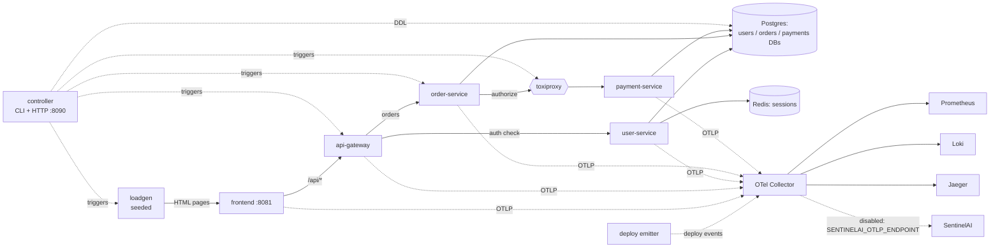

# Phase 2 — Testbed (plan, revision 2)

Status: **APPROVED 2026-11-17** (revision 2, with the user's answers and scale changes applied —
see §13). Revision 2 replaced revision 1 to follow the Phase 2 brief of 2026-11-17.
SentinelAI itself is not changed in this phase except for docs.

---

## 0. Environment findings (2026-11-17)

| Item | Finding | Impact |
|---|---|---|
| Repo | Phase 1 merged to `main`; work on branch `phase-2-testbed`. | — |
| WSL resources | Host has 8 GB RAM; WSL set to **4 GB** (3.9 GB visible), **4 CPUs**, 4 GB swap. 941 GB disk. | Testbed memory budget (§2.4); **SentinelAI's stack is stopped while the testbed runs**; containers may not use swap (§2.4). |
| Ports | Free: 3001, 3100, 4317, 4318, 8081–8090, 8474, 9090, 16686. **8080 is taken** (red-blue-range). | Testbed frontend on 8081. |
| `make` | GNU Make 4.3 installed in WSL. | Makefile targets run from WSL; `testbed/tb.sh` is kept as the single implementation and fallback. |

### 0.1 Hardware constraint and verification plan (added 2026-11-17, ADR 0004)

The laptop (8 GB RAM, WSL capped at 4 GB) **cannot run the testbed live**: the idle WSL VM costs
~700 MB, and within 22 s of `make testbed-up` it grew to ~1.6 GB while Windows' available memory fell
to 554 MB (floor 600 MB); the memory watchdog stopped the run. Therefore:

- **No containers run on the laptop.** Local work: editing, unit tests, ruff, mypy strict.
- **All live verification runs in a GitHub Codespace (4-core / 16 GB) or GitHub Actions**:
  `.devcontainer/devcontainer.json` and the manual workflow `.github/workflows/testbed-live.yml`
  (checks: `baseline`, `deploy-check`, then scenarios 1–5 as they land). Each run uploads its run
  record and Prometheus/Loki/Jaeger query outputs as artifacts; those are the evidence quoted in
  reports.
- The memory watchdog is configurable (`TB_MIN_AVAILABLE_MB`); on Linux it reads `/proc/meminfo`
  `MemAvailable` with a 1 GB default floor.
- **Status vocabulary:** a task is "done" only after its live check passes in a Codespace or CI.
  Until then it is "unit-tested only; NOT yet verified live". T5 is in that state.
- Instructions for the Codespace session: `docs/codespaces.md`.

---

## 1. Scope

**In:**
- **Services:** `frontend`, `api-gateway`, `user-service`, `order-service` and `payment-service`, with the testbed's own PostgreSQL and Redis.
- **Call chain:** frontend → gateway → order → payment → DB.
- **Telemetry:** OpenTelemetry traces, metrics and trace-correlated logs, sent to the OTel Collector, which fans out to Prometheus, Loki and Jaeger. A SentinelAI OTLP/HTTP exporter is configured but disabled.
- **Load generator:** seeded.
- **Fault controller:** CLI and HTTP, with start, stop and a reproducible trigger for each scenario.
- **Ground truth and deploy events:** a ground-truth JSON per scenario, and a deployment-event emitter.
- **Make workflow:** `make testbed-up`, `make testbed-down` and `make scenario-run ID=…`.
- **Scenarios:** five, implemented with full verification.

**Out:**
- **Remaining scenarios:** the other 10 from the original list (designed for, not built).
- **SentinelAI ingestion:** Phase 3.
- **Evaluation scoring:** Phase 6, though the record format it will read is designed here.

---

## 2. Architecture

### 2.1 Layout and the integrity boundary

```
testbed/
  services/        the system under test — ordinary app code (SentinelAI may read this in Phase 5)
    common/        shared telemetry + settings
    frontend/  api_gateway/  user_service/  order_service/  payment_service/
  scenarios/       ground-truth definitions <id>.json + schema/ — never given to SentinelAI
  harness/         controller (CLI + HTTP), scenario plugins, symptom checks, loadgen, deploy emitter
  otel/ prometheus/ loki/ jaeger/ grafana/   backend configs
  docker-compose.yml   Makefile targets live at the repo root
```

**ADR 0003:** SentinelAI may later read only `testbed/services/` and the telemetry. `scenarios/` and `harness/` contain the answers.
- **What faults may produce:** real symptoms only.
- **What they must never produce:** a marker in telemetry such as a "chaos" attribute or an "injecting…" log line.
- **How it's enforced:** tests check both.

### 2.2 Services and call chain (all Python 3.12 / FastAPI)



| Service | Role | Data |
|---|---|---|
| `frontend` | Server-rendered storefront: home, product list, account and order history, checkout. Every page calls the gateway. Only public port: 8081. | — |
| `api-gateway` | Routes `/api/*`; validates the session token with user-service; a small response cache for product lists. | — |
| `user-service` | Users, login, session lookup. | Postgres `users`, Redis sessions |
| `order-service` | Create, list and fetch orders; a daily sales report (`/internal/reports/daily`). | Postgres `orders`. Pool: 10 connections, overflow 0, 3 s timeout. |
| `payment-service` | Authorize and record payments. A simulated issuer decides each payment: about 3% declines, seeded per order id, so decisions are deterministic. | Postgres `payments` |

**Seed data:**
- **Users:** 5,000.
- **Products:** 300.
- **Orders:** about **500,000** historical orders (scaled for this hardware). Rows carry a realistic
  shipping address and line-item JSON so a sequential scan is real work. Scenario 2 must still show a
  clear before/after: its thresholds are relative to the baseline measured in the same run (§5), and
  the gap is measured during T2 — if 500k rows ever stop producing a clear gap, the row width, not the
  row count, is what gets tuned.
- **Payments:** one per order.

**All Python, not Node.** The brief allowed either. One toolchain keeps lint and type rules identical to the backend, and makes Phase 5's code reading uniform. A Node frontend would add realism but no Phase 2 value.

### 2.3 Telemetry

- **SDK:** OTel Python SDK with OTLP/HTTP export, set up once in `services/common/telemetry.py`.
- **Instrumentation:** FastAPI, httpx, SQLAlchemy (including connection-pool metrics), redis and logging.
- **Resource attributes:** `service.name`, `service.namespace=shop`, `service.version`, `service.instance.id` and `deployment.environment.name=testbed`.
- **Traces:** W3C propagation through the whole chain, current HTTP and DB semantic conventions, and errors recorded on spans with their exception.
- **Metrics:**
  - **HTTP:** server and client request-duration histograms.
  - **DB pool:** `db.client.connection.count`, `.max`, `.pending_requests`, `.timeouts` and `.wait_time`.
  - **Process:** memory and CPU (`process.memory.usage`, `process.cpu.time`).
  - **Business:** `shop.orders.created` and `shop.payments.declined`.
  - **Cardinality:** no user ids or order ids as metric labels.
- **Logs:** JSON, carrying `trace_id` and `span_id`, with stack traces on errors. They go through the OTel logs bridge to the Collector.
- **Collector pipelines:** `otlp` → `memory_limiter`, `resource`, `batch`. Then:
  - **Traces:** to Jaeger (OTLP).
  - **Metrics:** to Prometheus (its OTLP receiver).
  - **Logs:** to Loki (native OTLP).
  - **SentinelAI:** `otlphttp/sentinelai` is defined but only added to the pipelines when `SENTINELAI_OTLP_ENDPOINT` is set (a config overlay). It's off in Phase 2.

### 2.4 Containers, ports and memory

Separate Compose project (`name: sentinelai-testbed`, own network). Every port is published on
127.0.0.1 only. **Every container has `mem_limit` and an equal `memswap_limit`**, so no container can
grow into the 4 GB swap: a container that reaches its limit is OOM-killed inside its own cgroup and the
host is never at risk. Grafana is **off by default** (`ui` profile). Short retention: Prometheus
`retention.time=6h` + `retention.size=300MB`; Loki 6 h (compactor retention); Jaeger in-memory capped at
3,000 traces (revised from 10,000 during T7, 2026-11-17: measured ~235 MiB at 10,000 baseline traces and restarts under S1; see `testbed/infra/jaeger/jaeger.yaml`).

| Container | Host port | Mem limit |
|---|---|---|
| frontend | 8081 | 128 MB |
| api-gateway | — | **192 MB** (scenario 5 needs a limit it can reach) |
| user-service, order-service, payment-service | — | 160 MB each |
| postgres | — | 384 MB (500k-row orders table, `shared_buffers` 64 MB) |
| redis | — | 64 MB |
| toxiproxy | — | 48 MB |
| loadgen | — | 128 MB |
| controller | 8090 | 128 MB |
| otel-collector | 4318 | 192 MB |
| prometheus | 9090 | 256 MB |
| loki | 3100 | 256 MB |
| jaeger (v2, in-memory, capped traces) | 16686 | 256 MB |
| grafana (profile `ui`) | 3001 | 160 MB |

The limits sum to about 2.9 GB (3.1 GB with Grafana); real usage is expected well below and will be
measured and reported (`docker stats`). SentinelAI's stack is stopped while the testbed runs.
**Safety guard:** the controller reads the VM's `MemAvailable` before and during every run and aborts
(runs the scenario's stop) if it falls below 500 MB.

---

## 3. Fault-injection controller

One Python package, `testbed/harness`, exposed two ways: the CLI `tb scenario run|stop|status|list` and HTTP on :8090 (`POST /scenarios/{id}/start`, `POST /scenarios/{id}/stop`, `GET /runs/{run_id}`). Both call the same code.

**Built to be extended.** A scenario is a JSON definition (ground truth) plus a small Python plugin. The plugin composes reusable **trigger primitives** with **symptom checks**. Adding one of the ten later scenarios means adding a JSON file and a plugin; it's auto-discovered and the tests pick it up.

| Trigger primitive | Used by | Ready for (future scenarios) |
|---|---|---|
| `TrafficPattern` (switch loadgen to a named, seeded traffic mix) | S1, S5 | 500-spike, retry storms |
| `SqlChange` (DDL against the testbed DB, with its inverse) | S2 | lock contention |
| `Deploy` (release change + restart + deploy event) | S3 | bad code deploy |
| `NetworkToxic` (Toxiproxy: down, latency, timeout, bandwidth) | S4 | latency, timeouts |
| `ProcessStress` (in-service work generator via an internal ops port) | — | CPU saturation |

| Symptom check | Source | Example |
|---|---|---|
| `PromQL` threshold over a window | Prometheus | p95 latency, error ratio, pool pending |
| `LogQL` count | Loki | count of `timed out waiting for connection` |
| `TraceQuery` | Jaeger API | error spans for a service and operation, min duration |
| `Baseline` (the same checks, inverted) | all | "stop returns to baseline" |

**Safety rules:**
- **Targets:** the controller acts only on an allow-list of testbed targets.
- **No Docker socket:** restarts happen through each service's internal ops port.
- **Auth:** HTTP requires a token from `testbed/.env`.
- **One run at a time:** a lock file, so runs never overlap.
- **Idempotent start:** retrying a start for a run already in progress returns that run.

**Run lifecycle:** baseline check → trigger → observe window → symptom checks → stop → recovery window → baseline checks. Each step is logged.

---

## 4. Ground truth

- **Definition files:** `testbed/scenarios/<id>.json` is committed. It holds `id`, `injected_fault`, `root_cause` (category, service, component, summary, code_location if any), `expected_symptoms` (each with id, signal, the exact query and threshold), `expected_affected_services`, and a `timeline` with `started_at` and `ended_at`.
- **Runtime records** (decided): each run writes the same document with the times filled in, plus
  `run_id`, `seed` and the observed symptom results, to `testbed/runs/<id>/<run_id>.json`
  (gitignored), and copies it to `testbed/runs/<id>/latest.json`. The committed definition keeps
  `null` times, so runs never dirty the repo or overwrite each other.
- **Schema:** `testbed/scenarios/schema/ground-truth.schema.json` (JSON Schema 2020-12) validates both the definition (times null) and the runtime record (times required, symptoms observed).
- **Tests:** every registered scenario has a definition file, and it validates against the schema. Every expected symptom has a check implemented.
- **Verified, never assumed:** a runtime record is `verified` only if every expected symptom was observed during the window and the baseline returned after stop. Otherwise it's `failed` (CLAUDE.md invariant 9).
- **Root-cause categories:** `resource_exhaustion`, `slow_query`, `bad_deployment`, `dependency_unavailable` and `memory_leak`. The enum leaves room for `cpu_saturation`, `error_spike`, `latency`, `timeout`, `auth_failure` and others.

---

## 5. Scenarios

| # | Id | Reproducible trigger | Root cause (category · service) | Expected symptoms (each a query in the definition) | Stop |
|---|---|---|---|---|---|
| 1 | `db-pool-exhaustion` | Loadgen adds a seeded stream of `/internal/reports/daily` calls. The report holds its DB session open while it aggregates in Python, about 4 s each. | resource_exhaustion · order-service (DB connection pool) | `db_client_connection_pending_requests{service="order-service"} > 0` sustained; pool timeouts in logs (`QueuePool limit … timed out`); order-service 5xx share > 20%; error spans `order-service` → gateway → frontend; payment-service unaffected | Traffic pattern back to baseline |
| 2 | `slow-sql-missing-index` | `DROP INDEX ix_orders_user_id_created_at` (the order-history lookup) on the 500k-row table | slow_query · order-service (orders table) | `GET /orders` p95 latency ≥ 5× the run's own baseline p95; the DB span for that SELECT ≥ 10× its baseline and ≥ 25 ms in Jaeger; the frontend's account page slower by the same factor; no error spike | `CREATE INDEX` again; latency back within 1.5× baseline |
| 3 | `failed-deployment-bad-config` | Deploy user-service 2.4.0, whose config points `USER_DB_NAME` at a database that doesn't exist (`users_v2`). A deploy event is emitted. | bad_deployment · user-service | Deploy event for user-service 2.4.0 in Loki; user-service crash-loops on startup (`database "users_v2" does not exist`); gateway auth calls fail, so login and account pages return 502/503; `service.instance.id` keeps changing | Roll back to 2.3.0 (a second deploy event) |
| 4 | `payment-unavailable` | Toxiproxy disables the order → payment link (connection refused) | dependency_unavailable · payment-service | order-service client spans to payment-service error with connection refused; checkout 503 via gateway; payment-service request rate drops to 0; browsing unaffected | Re-enable the link |
| 5 | `memory-leak` (**bounded**) | Loadgen switches part of the traffic to a client that adds a cache-busting `?v=<nonce>` (seeded, fixed rate) to product-list calls. The gateway's response cache has no size bound, so every unique URL is kept. | memory_leak · api-gateway (response cache) | api-gateway `process_memory_usage` rises at a steady, predictable slope; latency creeps up; the container reaches its 192 MB cgroup limit (no swap) in **about 3–4 minutes** and is OOM-killed; restart visible as a new `service.instance.id` and a start log; brief 5xx during the restart | Traffic back to baseline, then gateway restart to free memory (recorded as recovery) |

Defaults: a 2-minute baseline, a 5-minute observe window and a 2-minute recovery window, all configurable per run (`--observe 120` for quicker runs).

**Why the leak is bounded and safe:** growth comes from a fixed-rate, seeded stream of unique URLs,
so the slope is predictable (calibrated in T8 to reach the limit in ~3–4 min, at most one OOM kill per
observe window). The cap is the container's own cgroup limit with swap disabled
(`memswap_limit = mem_limit`); the OOM kill happens inside that container only. On top of that the
scenario has a hard time limit, and the controller's `MemAvailable` guard (§2.4) stops any run that
squeezes the VM.

**Reproducibility ("same seed → same symptom pattern"):**
- **What's seeded:** every random source (loadgen arrivals and journeys, issuer declines, the nonce stream, seed data).
- **The fingerprint:** each run records a symptom fingerprint: the set of observed symptom ids, their order of onset, the onset offset in 15-second buckets, and magnitude buckets (for example, error share 20–40%).
- **The test:** run each scenario twice with the same seed and assert equal fingerprints, allowing ±1 onset bucket for scheduling jitter. Exact equality isn't promised; the tolerance is stated.

---

## 6. Load generator

- **Implementation:** custom asyncio plus httpx, seeded, open-model (Poisson arrivals).
- **Baseline:** about 10 requests per second as page journeys: browse 50%, product 20%, account/orders 15%, login 5%, checkout 10%.
- **Named traffic mixes:** `baseline`, `with-daily-reports` (S1) and `cache-busting-client` (S5).
- **Control:** the controller switches the mix through loadgen's internal control port.
- **Not instrumented:** loadgen plays the users, so it's not part of the system under test.
- **Stats:** a summary line every 10 s.

## 7. Deployment-event emitter

```bash
tb deploy <service> <version>
```

What a deploy does:
- **Release:** updates `releases.json`, which services read at start.
- **Restart:** restarts the service through its ops port.
- **Deploy event:** an OTel log record, `event.name=deployment`, with `service.name`, `service.version`, `deployment.previous_version`, `deployment.id` and a timestamp. It goes through the Collector, so it appears in Loki today and will reach SentinelAI from Phase 3 as a change event.
- **Local record:** an append-only line in `testbed/runs/deploy-events.jsonl`.

Scenario 3 uses the same command; it can also be run on its own.

## 8. Make workflow (repo root)

```
make testbed-up            # build + start, wait until healthy, seed data on first run
make testbed-down          # stop (add CLEAN=1 to wipe volumes)
make testbed-status
make scenario-list
make scenario-run ID=db-pool-exhaustion [SEED=42] [OBSERVE=300]   # full lifecycle, prints verdict
make scenario-start ID=… / make scenario-stop ID=…                 # manual control
make deploy SERVICE=user-service VERSION=2.4.0
make testbed-test          # testbed lint + typecheck + unit tests
```

`testbed/tb.sh` gives the same commands where `make` isn't installed.

---

## 9. Task list

Same bar as Phase 1: format, lint, mypy strict, tests and build with real output, and a commit after each green task.

| Task | Objective | Tests | Acceptance criteria |
|---|---|---|---|
| **T1** Skeleton | uv project, shared settings and telemetry module, single image with a command per service, compose with limits and healthchecks, `.env.example`, Makefile + `tb.sh`, ADR 0003 updated | settings; env-example coverage | `make testbed-up` from clean, all healthy |
| **T2** Services | 5 services, call chain, schemas + seed (500k orders, with the indexed vs unindexed query time measured), releases + ops port | unit per service; integration of checkout through all hops | scripted checkout via :8081 succeeds; trace spans all 5 services |
| **T3** Telemetry + Collector | instrumentation, pool and process metrics, log correlation, collector incl. disabled SentinelAI exporter | in-memory exporter tests (attributes, status, log↔trace ids); "no tell-tale words" test | collector shows all 3 signals from all 5 services |
| **T4** Backends | Prometheus (OTLP), Loki (OTLP), Jaeger v2, Grafana profile + golden-signals dashboard | integration: series, services and logs present per service | queries return data; `docker stats` within limits |
| **T5** Loadgen + deploy emitter | seeded journeys, traffic mixes, control port; `tb deploy` | same seed gives the same schedule; mix weights; deploy event schema | 10 min baseline < 0.5% errors (measured, reported) |
| **T6** Controller + ground truth | plugin interface, primitives, symptom checks, CLI + HTTP, schema, runtime records, lock, allow-list | lifecycle, idempotency, allow-list, schema validation, every scenario has a valid file | dry run writes a schema-valid record |
| **T7** S1 pool exhaustion | trigger + definition + checks | scenario test (marked, about 8 min): verified + baseline restored | output of every query, before/during/after |
| **T8** S2–S5 | four scenarios | scenario test each | same |
| **T9** Reproducibility + CI (note: the live-check workflow `testbed-live.yml` was pulled forward, ADR 0004) | fingerprint comparison; CI: testbed lint/type/unit per push, scenario suite on `workflow_dispatch` + nightly | same-seed fingerprint test per scenario | fingerprints equal within the stated tolerance |
| **T10** Docs + report | `docs/testbed.md` (each scenario's trigger, expected symptoms with exact queries, ground truth), `testbed/README.md`, PROGRESS | — | phase report with real outputs |

---

## 10. Acceptance criteria → proof

| Criterion | Proof I'll show |
|---|---|
| One command starts the testbed from clean; all healthy | `make testbed-up` output + `docker compose ps` |
| Each scenario produces its documented symptoms in Prometheus, Loki and Jaeger | Per scenario: the exact PromQL, LogQL and Jaeger API queries with their before/during/after results as text tables. Optional ASCII sparklines from Prometheus range queries |
| Stop returns to baseline | the baseline checks after the recovery window, with numbers |
| Same seed → same symptom pattern | two runs' fingerprints side by side + the test result |
| Ground truth validates; every scenario has one | schema test output |
| `docs/testbed.md` | the file |

## 11. Dependencies (each with reason)

**Python** (all in the testbed project, with the same choices as the backend where they overlap):
- **Web, data, client:** `fastapi`, `uvicorn`, `pydantic-settings`, `sqlalchemy[asyncio]` 2.0 + `asyncpg`, `redis`, `httpx`.
- **Templates:** `jinja2`, for the server-rendered frontend.
- **OpenTelemetry:** `opentelemetry-sdk`, the OTLP/HTTP exporter, and instrumentation for fastapi, httpx, sqlalchemy, redis and logging (the standard packages).
- **Validation:** `jsonschema`, for ground-truth validation.
- **CLI:** `typer`.
- **Dev:** `pytest`, `pytest-asyncio`, `ruff` and `mypy`.

**Images:**
- **Backends:** `otel/opentelemetry-collector-contrib`, `prom/prometheus` v3, `grafana/loki` v3, `jaegertracing/jaeger` v2 and `grafana/grafana`.
- **Fault injection:** `ghcr.io/shopify/toxiproxy`, for network faults without giving the controller the Docker socket.
- **Data:** `postgres:17-alpine` and `redis:7-alpine`.

All versions pinned at implementation.

## 12. Known limitations accepted for Phase 2

- **Scale:** a single machine, about 10 requests per second.
- **Jaeger:** in-memory, so traces are lost on restart.
- **Deploys:** modelled as in-place process restarts.
- **Scenario coverage:** five scenarios. The other ten are designed for but not built.
- **Reproducibility:** fingerprints match within a stated jitter tolerance, not to the millisecond.

## 13. Decisions (resolved 2026-11-17)

1. **Runtime ground truth:** committed definitions keep empty times; each run writes a filled copy to
   `testbed/runs/<id>/<run_id>.json` (gitignored) plus `latest.json`.
2. **Memory:** WSL stays at 4 GB on an 8 GB host. SentinelAI's stack is stopped while the testbed
   runs; every container has a memory limit with swap disabled; Grafana is off by default; Prometheus
   and Loki keep 6 hours.
3. **`make`:** installed in WSL; `testbed/tb.sh` stays as the implementation and fallback.
4. **Scale:** 500k orders for the slow-SQL scenario (clear before/after still required); the memory
   leak is bounded and reaches its limit in a few minutes without risk to the host (§5).
