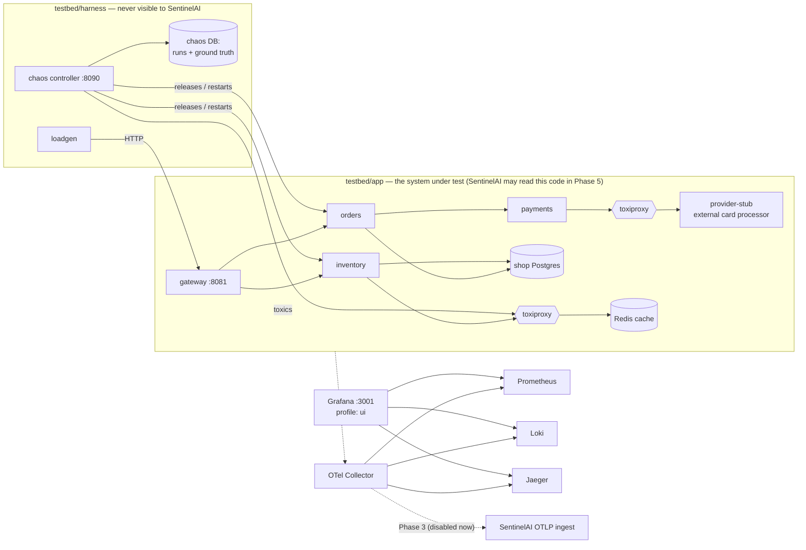

# Phase 2 — Testbed (plan)

Status: **PROPOSED — awaiting approval.** No code is written until this is approved.
Scope (CLAUDE.md phase map): a multi-service sample app + OpenTelemetry + fault injection with
ground-truth records. Out of scope: anything SentinelAI-side (OTLP ingestion, detection, incidents —
Phase 3), investigation (Phase 4), the evaluation harness (Phase 6; its input schema is designed here).

---

## 0. Environment findings (2026-11-17)

| Item | Finding | Impact |
|---|---|---|
| Repo | Phase 1 merged to `main` (fast-forward, `5041018`). | Phase 2 work on branch `phase-2-testbed`. |
| WSL memory | 3.8 GB total, ~2.36 GB available with the SentinelAI stack (~300 MB) and unrelated `red-blue-range-*` containers (~140 MB) running. 8 CPUs, 941 GB disk. | The testbed needs a memory budget (§2.4). Recommend raising WSL to 5–6 GB (§13). |
| Ports | Free: 3001, 3100, 4317, 4318, 8081, 8090, 8474, 9090, 16686. **8080 is taken** (red-blue-range dashboard). | Testbed gateway on 8081; Grafana on 3001 (SentinelAI frontend owns 3000). |
| Tooling | Docker 29.8 / Compose v5.6 in WSL, uv 0.13.8 / Python 3.12, Node 22 — unchanged. | Same toolchain as Phase 1. |

---

## 1. Goals and non-goals

**Goals**
1. A small but realistic **"shop"** system (4 services + Postgres + Redis + an external-provider
   stub) that emits **traces, metrics and logs** over OTLP with correct semantic conventions.
2. A **fault-injection harness** that can reproduce four failure scenarios on demand, with the
   golden path first: **#1 DB connection-pool exhaustion**.
3. A **ground-truth record** for every injected fault: what was done, when, the true root cause and
   the expected symptoms — **verified against the telemetry actually produced**, never just asserted.
4. A deterministic, seeded **load generator** so a baseline and a fault produce comparable signals.
5. Local observability backends (Prometheus, Loki, Jaeger, optional Grafana) so humans can see the
   signals now; the collector already has a disabled OTLP/HTTP exporter ready for SentinelAI's
   Phase 3 ingestion endpoint.

**Non-goals (Phase 2)**: SentinelAI ingesting anything; Kubernetes; more than 4 scenarios (a 5th is
listed as deferred); load beyond what this machine can run (~10–20 req/s baseline).

---

## 2. Architecture

### 2.1 Two halves: the system under test vs the harness



- **`testbed/app/`** is the monitored system. It is ordinary application code with realistic bugs
  that ship in specific *releases*. Nothing in it names faults, chaos or ground truth.
- **`testbed/harness/`** holds the load generator, the chaos controller and the ground-truth store.
  SentinelAI never gets its code, network or credentials (§9).
- Toxiproxy sits on the network links where infrastructure faults are injected (Redis, the external
  provider) so those faults look like real network problems.

### 2.2 The shop domain

| Service | Responsibility | Dependencies | Notes |
|---|---|---|---|
| `gateway` | Public HTTP API (`/api/products`, `/api/products/{sku}`, `/api/cart`, `/api/checkout`); fans out | orders, inventory | Only service with a published port (8081). |
| `orders` | Create orders, list orders, order status | Postgres (SQLAlchemy async pool **size 5, overflow 0, timeout 3 s**), payments | Scenario #1 lives here. |
| `inventory` | Product catalogue, stock levels, reservations | Redis cache (via toxiproxy), Postgres | Scenarios #3 and #4. |
| `payments` | Authorize/capture against the external processor | provider-stub (via toxiproxy), 2 s timeout, 1 retry | Scenario #2. |
| `provider-stub` | Simulated third-party card processor: ~120 ms latency, ~4% declines (seeded) | — | "External": `peer.service=card-processor`; not instrumented as part of the shop. |

Seed data: ~200 products across 6 categories, stock levels, a few hundred historic orders.

### 2.3 Releases (how app-level faults ship)

Each app service reads its active release from a read-only `releases.json` volume at startup and
reports it as `service.version`. A **deploy** = the chaos controller writes the new release and calls
the service's internal ops endpoint `POST /ops/restart` (separate, uninstrumented port, token-protected,
internal network only) → the process exits → Docker's restart policy starts it on the new release.
This mirrors a real rolling deploy: the version changes in telemetry, and so does the behaviour.

| Service | Good release | Bad release | The bug (real code, release-gated) |
|---|---|---|---|
| orders | 1.3.2 | **1.4.0** | Refactored decline handling returns early without releasing its DB session → connections leak on every payment decline. |
| inventory | 2.3.0 | **2.3.1** | New "bundle pricing" reads an optional `bundle_price` field with `product["bundle_price"]` → `KeyError` for products without it (~20% of the catalogue). |

### 2.4 Containers, ports, memory budget

Separate Compose project `testbed/docker-compose.yml` (`name: sentinelai-testbed`), its own network,
all published ports on 127.0.0.1. `mem_limit` on every container.

| Container | Port (host) | Mem limit | Profile |
|---|---|---|---|
| shop-postgres (DBs `shop`, `chaos`) | — | 256 MB | default |
| shop-redis | — | 64 MB | default |
| toxiproxy | — | 64 MB | default |
| gateway, orders, inventory, payments | 8081 (gateway only) | 160 MB each | default |
| provider-stub | — | 96 MB | default |
| loadgen | — | 128 MB | default |
| chaos controller | 8090 | 128 MB | default |
| otel-collector (contrib) | 4318 (debug only) | 192 MB | default |
| prometheus | 9090 | 256 MB | default |
| loki | 3100 | 256 MB | default |
| jaeger (v2 all-in-one, in-memory, capped trace count) | 16686 | 256 MB | default |
| grafana | 3001 | 160 MB | `ui` |

Limits sum to about 2.9 GB with Grafana, and about 2.7 GB without. Typical real usage will be well
below the limits, but **together with the SentinelAI stack it will not fit comfortably in today's
~2.4 GB of free WSL memory** (see §13).

---

## 3. Telemetry design

- **SDK**: OpenTelemetry Python SDK, OTLP/HTTP (protobuf) exporter, set up once in a shared module
  (`testbed/app/shop/common/telemetry.py`). Instrumentation: FastAPI, httpx, SQLAlchemy (incl.
  connection-pool metrics), redis, stdlib logging → OTel logs bridge.
- **Resource attributes** on every signal: `service.name`, `service.namespace=shop`,
  `service.version` (= release), `service.instance.id`, `deployment.environment.name=testbed`.
- **Traces**: W3C trace context across all hops; server/client spans with stable semconv
  (`http.request.method`, `http.response.status_code`, `url.path`, `db.system`, `db.operation.name`,
  `server.address`, `peer.service` for the provider); errors recorded as span status + exception event.
- **Metrics**: `http.server.request.duration`, `http.client.request.duration` (histograms),
  `db.client.connection.count` / `.max` / `.pending_requests` / `.timeouts` / `.wait_time` (pool
  saturation is scenario #1's main signal), Redis client errors, business counters
  (`shop.orders.created`, `shop.payments.declined`), process CPU/memory.
- **Logs**: structured, trace-correlated (`trace_id`, `span_id`), severity set properly; exceptions
  carry the stack trace (needed by Phase 4/5).
- **Collector pipelines** (`testbed/otel/collector.yaml`): receiver `otlp` (HTTP + gRPC) →
  processors `memory_limiter`, `resource` (adds `testbed.site=local`), `batch` → exporters:
  traces → Jaeger (OTLP); metrics → Prometheus (OTLP receiver on `/api/v1/otlp`); logs → Loki (native
  OTLP endpoint). A fourth `otlphttp/sentinelai` exporter is defined but **not in any pipeline** until
  Phase 3 (enabled by config overlay, endpoint via env).
- **Cardinality guard**: no user ids, order ids or SKUs as metric labels (only in spans/logs).

---

## 4. Fault injection

Two mechanisms, chosen so every fault produces genuine symptoms and no tell-tale markers:

1. **Releases** (app-level bugs): deploy a release containing a real bug (§2.3). Rollback = deploy the
   good release (which also resets the process, freeing leaked connections — as a real rollback would).
2. **Network toxics via Toxiproxy** (infra-level): latency, timeouts or a downed link between a service
   and Redis or the external provider. Cleared by removing the toxic.

**Safety rules:** the chaos controller acts only on an **allow-list** of testbed targets (named
services and proxies), never on Docker itself (no Docker socket), never on SentinelAI. The ops
endpoints listen only on the internal network and require a shared token from `testbed/.env`.

---

## 5. Ground truth

### 5.1 Record (schema v1, JSON Schema in `testbed/harness/ground_truth/schema/v1.json`)

```json
{
  "schema_version": 1,
  "run_id": "uuid",
  "idempotency_key": "client-supplied string",
  "scenario": {"id": "db-pool-exhaustion", "version": 1},
  "seed": 1234,
  "load_profile": {"id": "baseline-v1", "target_rps": 12},
  "timeline": {
    "baseline_started_at": "ts", "injected_at": "ts", "cleared_at": "ts|null",
    "recovered_at": "ts|null"
  },
  "fault": {
    "mechanism": "release | toxic",
    "target": {"service": "orders", "component": "db-connection-pool"},
    "parameters": {"release_from": "1.3.2", "release_to": "1.4.0"}
  },
  "root_cause": {
    "category": "resource_exhaustion | dependency_latency | dependency_unavailable | code_regression",
    "service": "orders",
    "component": "postgres connection pool",
    "summary": "Release 1.4.0 leaks a DB connection on every payment decline; the 5-connection pool is exhausted and requests time out waiting for a connection.",
    "code_location": {"path": "testbed/app/shop/orders/service.py", "symbol": "create_order"},
    "change": {"type": "deploy", "service": "orders", "from": "1.3.2", "to": "1.4.0", "at": "ts"}
  },
  "affected_services": ["orders", "gateway"],
  "expected_symptoms": [
    {"id": "pool-timeouts", "service": "orders", "signal": "logs", "match": "timed out waiting for a connection"},
    {"id": "pool-saturated", "service": "orders", "signal": "metrics", "query": "db_client_connection_pending_requests > 0 for 60s"},
    {"id": "gateway-5xx", "service": "gateway", "signal": "metrics", "query": "5xx share of /api/checkout > 20%"}
  ],
  "verification": {
    "status": "verified | failed | pending",
    "checked_at": "ts",
    "results": [{"symptom_id": "pool-timeouts", "observed": true, "evidence": "loki query + count"}]
  }
}
```

### 5.2 Rules
- **Ground truth is verified, not assumed.** After the injection window, the controller queries
  Prometheus, Loki and Jaeger for each expected symptom and stores the results. A run whose symptoms
  are not observed is `failed` and excluded from evaluation (CLAUDE.md invariant 9: no fabrication).
- **Lifecycle**: `planned → baseline → injected → cleared → recovered | failed`, every transition an
  append-only event row with a timestamp (UTC, ms precision).
- **Idempotency**: `POST /runs` takes an idempotency key; retrying never starts a second injection.
  Only one active run at a time (a DB unique partial index), so runs never overlap.
- **Storage**: the `chaos` database in the testbed Postgres (tables `runs`, `run_events`,
  `ground_truth`). Export: `GET /runs/{id}` and `harness export --since … > runs.jsonl`.
- **Phase 6 alignment**: the eval harness will join SentinelAI's incidents/reports to these records
  by time window and affected services, scoring detection, timing, RCA category/service/component and
  evidence coverage. `schema_version` lets it evolve.

---

## 6. Scenarios

| # | Id | Mechanism | Root-cause category | Main symptoms | Recovery |
|---|---|---|---|---|---|
| **1** | `db-pool-exhaustion` (**golden path**) | Release orders 1.3.2 → 1.4.0 | resource_exhaustion | Pool pending requests and wait time climb as declines leak connections; after ~1–3 min orders requests time out (`TimeoutError` waiting for a connection); checkout 5xx at the gateway; product browsing unaffected | Roll back to 1.3.2 |
| 2 | `payment-provider-latency` | Toxic: +2500 ms ±500 latency on payments → provider | dependency_latency | Provider client spans ~2 s and timing out; payments retries; checkout latency p95 > 4 s and 5xx; orders healthy otherwise | Remove toxic |
| 3 | `inventory-bad-deploy` | Release inventory 2.3.0 → 2.3.1 | code_regression | `KeyError: 'bundle_price'` with stack traces on ~20% of product-detail requests; 500s on those SKUs only; version change visible in `service.version` | Roll back to 2.3.0 |
| 4 | `cache-outage` | Toxic: inventory → Redis link down | dependency_unavailable | Redis connection errors in inventory logs; fallback to Postgres → inventory latency and DB query rate up; no 5xx | Remove toxic |
| 5 | *(deferred)* `cpu-saturation` | — | — | — | — |

Each scenario defines: preconditions (healthy baseline), the injection, the injection window
(default 5 min), the expected symptoms (§5.1) with thresholds, and the clear/recovery steps.
Durations are configurable so CI can run a short version.

---

## 7. Load generator

Custom asyncio + httpx client (no extra framework), **seeded** for reproducibility. Open-model
arrivals (Poisson) at a target rate, user journeys with fixed weights: browse list 45%, product
detail 30%, add to cart 15%, checkout 10%. Baseline `baseline-v1` ≈ 12 req/s, which gives ~1–2
checkouts/s and a steady stream of payment declines (needed for scenario #1). It is **not
instrumented** (it plays the users, not part of the system) and logs one summary line per 10 s.

---

## 8. What SentinelAI will (and won't) see

| Visible to SentinelAI (later phases) | Never visible |
|---|---|
| OTLP telemetry from the shop services, including `service.version` changes | Chaos controller, its DB, its API, its logs |
| `testbed/app/` source code (Phase 5 code investigation) | `testbed/harness/` source (contains scenario answers) |
| — | Ground-truth records (only the Phase 6 eval harness reads them, after the investigation) |

Rules enforced by tests: no attribute, log line or metric in the app says "fault", "chaos",
"inject", "scenario" or "ground truth"; the harness emits no OTLP into the collector.

---

## 9. Evaluation integrity

Recorded as **ADR 0003**: the separation in §8 is what makes Phase 6 numbers honest. If an agent
could read a hint (a log line saying "injecting leak"), detection and RCA accuracy would be inflated.
A grep-based test over `testbed/app/` plus a telemetry-content test (§10, T3/T7) guard it.

---

## 10. Task list

Branch `phase-2-testbed`; conventional commits after each green task; same verification bar as
Phase 1 (format, lint, mypy strict, tests, build, real output).

### T1 — Testbed skeleton
- **Objective:** uv project (`testbed/pyproject.toml`, packages `shop` under `app/` and `harness`),
  shared settings, Dockerfile (one image, command per service), `testbed/docker-compose.yml` with
  network, volumes, mem limits, healthchecks; `testbed/.env.example`; ADR 0003.
- **Tests:** settings/unit smoke; a test that `.env.example` covers every compose variable.
- **AC:** `docker compose -f testbed/docker-compose.yml config` valid; the empty services start healthy.

### T2 — Shop services (good releases)
- **Objective:** gateway, orders, inventory, payments, provider-stub with the endpoints of §2.2,
  schema + seed data, release loading, ops endpoint (restart) on an internal port.
- **Tests:** unit tests per service (pricing, stock reservation, order state machine, payment retry);
  integration tests against real Postgres/Redis (checkout happy path; decline path returns 402).
- **AC:** with the stack up, a scripted checkout through `127.0.0.1:8081` succeeds; healthchecks green.

### T3 — Telemetry + collector
- **Objective:** shared OTel setup, all instrumentations, pool metrics, log correlation, collector
  config (incl. the disabled SentinelAI exporter).
- **Tests:** in-process tests with the SDK's in-memory exporters (span names/attributes/status,
  metric names, log↔trace correlation); the "no tell-tale words" test over app telemetry.
- **AC:** collector debug output shows all three signals from all four services with the resource
  attributes of §3.

### T4 — Observability backends
- **Objective:** Prometheus (OTLP receiver), Loki (OTLP), Jaeger v2, Grafana (profile `ui`) with
  provisioned data sources and one "shop golden signals" dashboard.
- **Tests (integration):** after a minute of traffic, Prometheus returns series for each service,
  Jaeger lists the 4 services, Loki returns logs per `service_name`.
- **AC:** queries above return data; memory within limits (`docker stats` output recorded).

### T5 — Load generator
- **Objective:** seeded open-model generator with the journey mix; profiles `baseline-v1`, `smoke`.
- **Tests:** unit tests for arrival scheduling (seeded → identical schedule), journey weights within
  tolerance, graceful shutdown.
- **AC:** 10 minutes of `baseline-v1` with < 0.5% errors and stable p95 (numbers recorded, not targets
  invented in advance).

### T6 — Chaos controller + ground truth
- **Objective:** FastAPI app + CLI (`harness run|status|clear|export`), run state machine, allow-list,
  release deploy/rollback, toxiproxy client, ground-truth schema v1 + validation, verification engine
  (Prometheus/Loki/Jaeger queries), the `chaos` DB with Alembic migrations.
- **Tests:** unit (state machine, idempotency key, single active run, allow-list rejects unknown
  targets, schema validation); integration (start/clear a toxic run against real toxiproxy; DB
  constraints).
- **AC:** a dry-run scenario produces a schema-valid record with an event timeline.

### T7 — Scenario #1 end-to-end (golden path)
- **Objective:** orders 1.4.0 with the leak; scenario definition; verification queries.
- **Tests:** scenario test (marked `scenario`, ~6 min): baseline → deploy 1.4.0 → symptoms observed →
  rollback → recovered; asserts ground truth `verified` and every expected symptom observed; asserts
  no tell-tale words reached Loki/Jaeger.
- **AC:** test passes; Grafana/Jaeger screenshots of the incident attached to the report.

### T8 — Scenarios #2–#4
- **Objective:** definitions, inventory 2.3.1 bug, toxics, verification for each.
- **Tests:** one scenario test each (short durations).
- **AC:** each run ends `verified`; ground-truth records exported as JSONL.

### T9 — CI
- **Objective:** testbed lint/type/unit job on every push; a `workflow_dispatch` + nightly job that
  starts the testbed and runs the scenario tests (too slow and heavy for every push).
- **AC:** actionlint clean; both jobs reproduced locally in clean Linux containers (as in Phase 1).

### T10 — Docs + phase report
- **Files:** `testbed/README.md` (run, inject, read ground truth), `docs/architecture/testbed.md`,
  ADR 0003, `docs/PROGRESS.md`; phase report.

---

## 11. Acceptance criteria → proof

| Criterion | Proof |
|---|---|
| Testbed starts healthy from a clean state, within its memory budget | `compose up --wait`, `docker stats` |
| All four services emit traces, metrics and logs with correct resource attributes | T3/T4 tests + Jaeger/Prometheus/Loki query output |
| Scenario #1 reproduces pool exhaustion with verified ground truth, then recovers | T7 scenario test output + exported record |
| Scenarios #2–#4 likewise | T8 outputs + JSONL |
| Ground truth is invisible to the system under test's telemetry and code | integrity tests (§9) |
| Lint, mypy strict, unit + integration tests green; CI definitions valid | command output |

## 12. Dependencies (each with reason)

Python (testbed project): `fastapi`, `uvicorn`, `pydantic-settings`, `sqlalchemy[asyncio]` 2.0 +
`asyncpg`, `alembic` (chaos DB), `redis`, `httpx` — same choices as the backend for consistency;
`opentelemetry-sdk`, `opentelemetry-exporter-otlp-proto-http`,
`opentelemetry-instrumentation-{fastapi,httpx,sqlalchemy,redis,logging}` — the standard OTel
instrumentations; `jsonschema` — validating ground-truth records against the published schema;
`typer` — the harness CLI. Dev: `pytest`, `pytest-asyncio`, `ruff`, `mypy`.
Images: `otel/opentelemetry-collector-contrib`, `prom/prometheus` (v3, OTLP receiver),
`grafana/loki` (v3, OTLP), `jaegertracing/jaeger` (v2), `grafana/grafana`, `ghcr.io/shopify/toxiproxy`
(network fault injection without Docker-socket access), `postgres:17-alpine`, `redis:7-alpine`.
Exact versions pinned at implementation.

## 13. Decisions I need from you

1. **WSL memory (recommended: raise to 6 GB).** The testbed plus SentinelAI needs roughly 3–3.5 GB
   at runtime; WSL has 3.8 GB total today. Create `%USERPROFILE%\.wslconfig` with `[wsl2]` /
   `memory=6GB`, then `wsl --shutdown`. Without it I'll run the testbed and the SentinelAI stack one
   at a time, and Grafana only on demand.
2. **All-Python services (recommended)** vs one service in Go/Node for polyglot realism. Python keeps
   one toolchain and makes Phase 5's code investigation simpler; polyglot is closer to real fleets.
3. **Toxiproxy for infrastructure faults (recommended)** vs app-level simulation only. Toxiproxy
   produces real network behaviour (timeouts, refused connections) without giving the harness Docker
   socket access.

## 14. Known limitations accepted for Phase 2

Single-machine scale (≈12 req/s), in-memory Jaeger (traces lost on restart), no Kubernetes, no
multi-region; four scenarios; deploys modelled as process restarts on one container per service.
