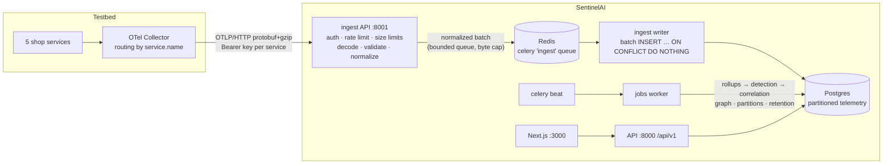

# Phase 3 — Incident management (plan, revision 1)

Status: **DRAFT — awaiting approval.** No code is written until this plan is approved.
Scope: service registry + ingest keys, OTLP/HTTP ingestion, telemetry storage, dependency graph,
deterministic detection, correlation into incidents, incident APIs and UI.

---

## 0. Environment findings (2026-11-19, inspected in the Codespace)

| Item | Finding | Impact |
|---|---|---|
| Repo | `main` clean at `7cc4505` (PR #1 merged: Phase 2 is on `main`). `docs/PROGRESS.md` still says "Phase 2 … not merged" — corrected in the Phase 3 report. | Work on branch `phase-3-incident-management`. |
| Machine | GitHub Codespace, 4 cores, 15 GiB RAM (11 GiB available with the testbed up), Docker 29.10, Node 26.13, Python 3.12.16, uv 0.13.8. | Both stacks can run at the same time here (ADR 0004's "stop SentinelAI while the testbed runs" was a laptop limit). |
| Ports in use | Testbed: 3100, 4318, 8081, 8089, 8090, 9090, 16686. Free: 3000, 5432, 6379, 8000, 8001. | SentinelAI API on 8000, ingest on **8001**. |
| Backend | Phase 1 only: auth, orgs, RBAC, projects, audit; `TenantRepository` + keyset pagination; one migration (`0001`); Celery worker, **no beat**. Fixed-window Redis rate limiter (fails closed). | Phase 3 adds a beat process and migration `0002+`. |
| Frontend | Next 16.4, React 19.3, TanStack Query 5; projects pages only. No Recharts or React Flow yet. | Two new dependencies (§10). |
| Testbed telemetry | All 5 services export OTLP/HTTP to the Collector. Overlay `collector.sentinelai.yaml` adds an `otlphttp/sentinelai` exporter when `SENTINELAI_OTLP_ENDPOINT` is set (protobuf + gzip by default). Deploy events are OTel logs with `event.name=deployment`. Payment declines are HTTP 200 (not errors); quiet baseline measured 0 errors in Phase 2. | Ingest must accept OTLP **protobuf with gzip** (the exporter default) as well as JSON. |
| Phase 1 carry-over | Project delete is a hard delete; Phase 1 noted it must become an archive before child data exists. | Done in T1, since services hang off projects. |

---

## 1. Scope

**In:** everything in the brief (registry + keys, ingestion, storage + retention + ADR, dependency
graph, five detection rules, correlation, incident API, Overview / Incidents / Service Map UI), plus
two things the acceptance criteria need: an incident **detail** page (the detection explanation has
to be readable somewhere) and the service registry UI (keys must be creatable without curl).

**Out (later phases):** investigations, evidence store, LLM anything (Phase 4); SSE (Phase 4 — the
UI polls every 15 s for now; incident timeline events already get monotonic ids so SSE can replay
them); notifications; Postgres RLS (Phase 6); ClickHouse/Loki storage (ADR 0005 scale-up path).

**Integrity boundary (ADR 0003).** `backend/` never reads `testbed/scenarios/`, `testbed/runs/` or
`testbed/harness/`, and has no rule, threshold or name derived from a scenario. The only thing that
compares SentinelAI output with ground truth is an evaluation command on the harness side (§8) that
calls SentinelAI's public API. Guard test in T1: a grep over `backend/app` for those paths and for
scenario ids fails the build. The backend image's build context is `./backend`, so it cannot see the
testbed at all.

---

## 2. Architecture



- **Separate ingest process.** Same image and codebase (modular monolith), but a second uvicorn
  container (`ingest`, `app.ingest_main:app`) that mounts only the OTLP routes. A telemetry flood
  then cannot starve the UI/API's event loop or DB pool. Its own DB pool is small (it only reads
  key rows; writes happen in the worker).
- **Workers.** Two Celery queues: `ingest` (writer, concurrency 2) and `jobs` (detection pipeline
  etc., concurrency 2). New `beat` container drives the schedule. Each periodic job takes a
  Postgres advisory lock, so overlapping runs skip instead of doubling work.
- **Pipeline order is fixed:** rollup → detection → correlation run as one chain per tick (15 s),
  so correlation always sees the detections of the same tick.
- **State in Postgres, not memory.** Detector states, watermarks and rollups are rows, so a killed
  worker resumes where it stopped (invariant 5).

---

## 3. Data model (migrations `0002`–`0005`, one per task that needs it)

All tenant-owned tables carry `org_id`; children use composite FKs `(org_id, parent_id)` so no row
can reference another tenant's parent (ADR 0002 §5). Every table gets a `TenantRepository`
(the architecture test already enforces this).

### 3.1 Registry (T1)

| Table | Key columns | Notes |
|---|---|---|
| `projects` (changed) | `archived_at` | Delete becomes archive (admin); archived projects are read-only. |
| `services` | `org_id, project_id, name, description, environment, repo_url, deployment` (JSONB: platform, runtime, current version — validated schema), `telemetry_config` (JSONB: `memory_limit_bytes`, rule overrides — validated), `health_status` (`unknown/healthy/degraded/unhealthy`, set by detection only), `last_seen_at` | `UNIQUE (org_id, project_id, environment, name)`; `name` must match OTel `service.name`. |
| `service_declared_dependencies` | `org_id, service_id, target_service_id` **or** `target_external` (e.g. `postgresql://orders`) | Declared edges come from here only. |
| `service_api_keys` | `org_id, service_id, name, prefix (12 chars, unique), secret_hash (SHA-256), created_by, created_at, last_used_at, revoked_at` | Plaintext shown once at creation. |

**Key design.** Format `sai_<prefix>_<32 random bytes, base64url>`. The secret is high-entropy, so a
SHA-256 hash is enough (no Argon2 cost on every OTLP request); lookup by prefix, constant-time
compare. Revocation is a timestamp; the ingest process caches key lookups for **10 s**, so a revoked
key stops working within 10 s (documented, tested). Creating/revoking keys needs **admin**; services
CRUD needs **engineer**; viewers read. All key events are audited (never the secret).

**Binding.** A key belongs to one service. On ingest, every resource whose `service.name` differs
from the key's service is **rejected and counted** (`service_mismatch`), not stored. For the testbed,
the Collector overlay uses the contrib `routing` connector to send each `service.name` to its own
exporter with its own key (5 exporters).

### 3.2 Telemetry (T2) — range-partitioned by day, see ADR 0005

| Table | Partition key | Dedup (unique) key | Stored |
|---|---|---|---|
| `spans` | `start_time` | `(org_id, trace_id, span_id, start_time)` | service_id, instance id, version, parent_span_id, name, kind, end_time, duration_ms, status (ok/error/unset), http method/route/status, `peer_service` / `db_system` / `server_address`, exception type + message (first exception event, truncated), attributes JSONB (allow-listed keys, values ≤ 256 chars, ≤ 32 keys) |
| `log_records` | `ts` | `(org_id, record_hash, ts)` — SHA-256 of service, ts, severity, body, trace/span id | severity number/text, body (≤ 8 KB), trace_id, span_id, exception type/message/stack (≤ 16 KB), attributes JSONB (bounded as above) |
| `metric_series` | — (not partitioned) | `(org_id, series_hash)` | service_id, name, unit, type (gauge/sum/histogram), monotonic flag, attributes incl. instance id |
| `metric_points` | `ts` | `(series_id, ts)` | value (gauge/sum), or count/sum/bucket_counts/explicit_bounds (histogram), start_ts (counter resets) |
| `deployments` | — | `(org_id, service_id, deployment_id, status)` | version, previous_version, status, ts — normalized from `event.name=deployment` log records |
| `ingest_usage` | — | `(org_id, key_id, minute, signal)` | accepted, rejected per reason (JSONB counters) — the "counted" in "counted and dropped" |

- IDs: `trace_id` `bytea(16)`, `span_id` `bytea(8)` (half the size of hex text).
- **Cardinality guard:** at most 2,000 series per service (config). Points for new series beyond
  that are dropped and counted (`series_limit`).
- **Timestamp window:** records must fall within `[now − 2 h, now + 5 min]` (config). Others are
  dropped and counted (`too_old` / `in_future`). Partitions exist for that whole window at all
  times (§3.4), so an insert never lands in a missing partition; if one ever does, the batch fails
  and is retried, it is not silently lost.
- **Indexes come from the query list below** and each new query is checked with
  `EXPLAIN (ANALYZE, BUFFERS)` on seeded data in its task; the plans go in the task's commit/report.

| Query (who runs it) | Index (per partition) |
|---|---|
| Server-span window stats per service: count, errors, p50/p95/p99 over 15 s buckets (rollup job) | `spans (org_id, service_id, start_time) WHERE kind = 'server'` |
| Cross-service parent/child edges in the last N minutes (graph job) | `spans (org_id, trace_id)` + dedup key (parent lookup by span_id within trace) |
| Error traces + exception signatures for a service/window (detection evidence) | `spans (org_id, service_id, start_time) WHERE status = 'error'` |
| Logs for a service/window by severity (detection evidence, exception signatures) | `log_records (org_id, service_id, ts)` |
| Logs by trace (incident detail, Phase 4) | `log_records (org_id, trace_id) WHERE trace_id IS NOT NULL` |
| Metric points for a series in a window (saturation rules) | dedup key `(series_id, ts)` |
| Series by service and metric name | `metric_series (org_id, service_id, name)` |

### 3.3 Graph, detection, incidents (T6–T8)

| Table | Key columns |
|---|---|
| `service_edges` | `org_id, source_service_id, target_service_id` or `target_external`, `source` (`declared`/`observed`, CHECK), first_seen, last_seen, `call_count` (observed), `sample_trace_id` (observed evidence) or `declared_dependency_id` (declared evidence). `UNIQUE (org_id, source_service_id, target, source)`. CHECK: observed ⇒ sample_trace_id NOT NULL; declared ⇒ declared_dependency_id NOT NULL. **No other way to create an edge.** |
| `service_window_stats` | `org_id, service_id, bucket_start (15 s), requests, errors, p50/p95/p99_ms, dominant exception signatures` — rollup used by detection, Overview and the service map. 30-day retention. |
| `detector_states` | `org_id, service_id, rule, state (ok/pending/firing/resolving/warming_up), since, last_value, last_evaluated_at, open_detection_id` — survives restarts. |
| `detections` | `org_id, service_id, rule, severity, metric, observed_value, baseline_value, threshold, started_at, fired_at, peak_value, resolved_at, explanation (text), evidence (JSONB: query window, sample counts, ≤ 20 sample trace ids, exception signatures, deployment id)`. `UNIQUE (org_id, service_id, rule, started_at)` → retried ticks cannot duplicate. |
| `incidents` | `org_id, project_id, number (per-org sequence), title, status, severity, started_at, detected_at, last_activity_at, resolved_at, created_at`. |
| `incident_detections` | `org_id, incident_id, detection_id (UNIQUE), reasons (JSONB list: {type, detail, refs})` — why each detection was grouped. |
| `incident_services` | `org_id, incident_id, service_id, role (`affected`)` — for the service filter. |
| `incident_events` | `id BIGSERIAL` (monotonic, for Phase 4 SSE replay), `org_id, incident_id, type, actor (system/user id), payload, created_at`. |

---

## 4. Ingestion (T3, T4)

`POST /api/v1/otlp/v1/{traces,logs,metrics}` on the ingest process (the Collector's `otlphttp`
exporter appends `/v1/traces` etc. to its endpoint, so the endpoint is `…/api/v1/otlp`).

Request path, in order (cheapest rejection first):
1. **Size.** `Content-Length` ≤ 4 MiB (413 otherwise); body read with a hard cap; gzip
   decompressed through a streaming decoder capped at 16 MiB (zip-bomb guard → 413).
2. **Auth.** `Authorization: Bearer sai_…` → key (cached 10 s). Missing/invalid/revoked → 401.
3. **Rate limit per key** (Redis, existing fixed-window limiter in 1 s windows): requests/s and
   records/s, defaults 50 req/s and 20,000 records/s per key → **429 + `Retry-After`**. Fails closed
   (503) if Redis is down, as today.
4. **Decode** by `Content-Type`: `application/x-protobuf` (via `opentelemetry-proto`) or
   `application/json` (OTLP JSON: hex ids, string int64s). Undecodable → **400**, counted
   (`malformed_payload`), nothing stored.
5. **Validate + normalize per record** into internal Pydantic/dataclass rows: id lengths, timestamp
   window, required fields, bounded attributes, `service.name` binding. Bad records are dropped and
   counted per reason; the response is OTLP **partial success** (`rejected_spans` /
   `rejected_log_records` / `rejected_data_points` + message). An exception inside one record's
   normalization drops that record, never the process.
6. **Enqueue (bounded).** The normalized batch (compact, zstd/gzip-compressed JSON) goes to the
   Celery `ingest` queue only if the queue's tracked byte total stays under the cap (default
   64 MiB, atomic Lua check-and-add). Over the cap → **503 + `Retry-After: 5`**. 200 is returned only
   after the enqueue succeeds.

**Writer** (`ingest` queue): `INSERT … ON CONFLICT DO NOTHING` in batches of ≤ 1,000 rows per table,
one transaction per batch, then decrements the byte counter, upserts `ingest_usage`, updates
`services.last_seen_at`, and normalizes deployment log records into `deployments`. A retried
message or a re-sent OTLP batch therefore inserts nothing new (invariant 6). Failures retry with
exponential backoff + jitter (max 5), then go to a dead-letter list that is counted and capped.

**Metrics** (Prometheus, both processes): `ingest_requests_total{signal,outcome}`,
`ingest_records_total{signal,outcome,reason}`, `ingest_queue_bytes`, `ingest_write_seconds`,
`ingest_lag_seconds` (record time → row written).

**Why 429 and 503 both:** 429 means "this key is over its rate"; 503 means "SentinelAI is behind".
Both carry `Retry-After`, and both are retryable for the OTel Collector's exporter, which honours
`Retry-After` — so overload slows senders down instead of growing memory.

---

## 5. Dependency graph (T6)

- **Declared** edges: rebuilt from `service_declared_dependencies` whenever a service is saved.
- **Observed** edges: a job every 60 s finds, in the last 2 minutes of spans, child spans whose
  parent span is in a **different registered service** (same trace, `parent_span_id = span_id`), and
  CLIENT spans with `db.system` / `server.address` and no matching child (external dependencies such
  as `postgresql` on `orders`). Each edge row keeps one sample trace id as evidence and a call count.
  The job is bounded (time window + `LIMIT`), runs in SQL, and is idempotent (upsert on the unique key).
- One logical connection can have two rows (declared + observed); the API returns both with their
  `source`, and the map draws "declared only", "observed only" and "both" differently.
- `GET /api/v1/orgs/{org_id}/service-graph?project_id=` returns nodes (services + externals, with
  health status and last-15-min request/error counts from `service_window_stats`) and edges.

---

## 6. Detection (T7) — deterministic, explainable

Runs every **15 s** on rollups up to `now − 30 s` (lag so late-arriving data doesn't look like a
drop). Each rule is a small pure function `(window stats, baseline, config) → condition`, wrapped in
one shared state machine:

```
ok ──cond true──▶ pending ──cond true for min_duration──▶ FIRING (detection row created)
 ▲                  │cond false                              │ below clear threshold
 └──────────────────┘                                        ▼
 ok ◀── below clear threshold for clear_duration ── resolving ──cond true again──▶ firing
```

**Hysteresis** = separate fire and clear thresholds; **minimum duration** = `pending` must hold
before anything is emitted; **minimum sample size** = windows with too few requests evaluate as
"no data", never as an anomaly. A rule without enough baseline is `warming_up` (shown in the UI),
never firing.

| Rule | Signal | Fires when (defaults; overridable per service in `telemetry_config`) | Clears when |
|---|---|---|---|
| `error_rate` | server spans, 60 s window | error ratio ≥ **5%** with ≥ **20** requests, held **60 s** | < **2%** for 120 s |
| `latency_shift` | server-span p95, 60 s window, vs baseline = median of per-minute p95 over the previous **30 min** (minutes when this rule was firing excluded; needs ≥ 10 such minutes) | p95 ≥ **3×** baseline **and** ≥ baseline + **100 ms**, ≥ 20 samples, held **120 s** | < 1.5× baseline for 120 s |
| `resource_saturation` | metrics: `db.client.connection.*` (used/max, pending_requests); `process.memory.usage` vs declared `memory_limit_bytes` (only if declared) | pool used/max ≥ **0.9** and pending > 0, held 60 s; or memory ≥ **85%** of limit, held 60 s | pool used/max < 0.7 and pending = 0 for 120 s; memory < 70% |
| `health_check` | telemetry heartbeat + instance churn (passive) | no telemetry for **90 s** from a service that sent data in the previous 10 min; or ≥ **3** new `service.instance.id`s within 5 min (crash loop) | telemetry back and no new instance for 120 s |
| `deploy_change` | `deployments` + other detections | a deployment of service X, followed within **10 min** by another rule firing on X or on a service with an edge to X | the linked detections resolve |

**Severity** is computed, not guessed: `warning` on firing; `critical` only if the value is beyond a
second, higher threshold (error ratio ≥ 25%, latency ≥ 10×, pool pending sustained, crash loop,
heartbeat lost) **and** the detection has been firing ≥ 3 min. A short blip therefore cannot be
critical, and normal fluctuation cannot fire at all (it has to pass sample size + threshold +
duration).

**Explanation** is a template filled from stored numbers, for example:
> *order-service: error rate 55.6% (412 of 741 server requests) over 60 s ending 19:31:45Z, above the
> 5% threshold for 75 s (fires after 60 s). Baseline over the previous 30 min: 0.0%. Top exception:
> `TimeoutError: QueuePool limit … timed out` (388 spans). Sample traces: 3f2a…, 91c0…*

Each detection stores everything that sentence uses, so the UI and Phase 4's evidence store can cite
it without recomputing. The **active probe** (SentinelAI calling a `/healthz` URL) is **not** in this
phase: it is an SSRF surface that needs an allow-list design, and the testbed's services are not
reachable from outside their network. Passive health covers S3's crash loop. (Decision D5.)

---

## 7. Correlation (T8)

When a detection fires, the correlator (same tick, under a per-org advisory lock) scores it against
every **open** incident whose `last_activity_at` is within **10 min**:

| Reason | Holds when | Recorded refs |
|---|---|---|
| `shared_trace` | a sample trace id of the new detection appears in the error traces of a detection already in the incident (checked in SQL against `spans`, bounded) | trace ids |
| `dependency_edge` | the new detection's service has a direct edge (either direction, any source) to a service in the incident | edge ids + sources |
| `exception_signature` | same normalized exception signature (type + message with numbers/ids/hex stripped, hashed) | signature |
| `deploy_proximity` | a deployment on the detection's service or an incident service within 10 min before the earliest detection | deployment id |
| `same_service` | the incident already contains a detection on the same service | detection id |

**Rule:** a detection joins an incident only if it is inside the time window **and** has at least
one structural reason above. Time proximity alone never merges (unit-tested explicitly). Several
candidates → highest score (shared_trace 3, exception_signature 3, dependency_edge 2,
deploy_proximity 2, same_service 1), ties to the oldest incident. No candidate → new incident. The
reasons are stored on `incident_detections` and shown in the UI.

**Incident fields are derived, not invented:** title from services and rules ("Errors and latency
in order-service, api-gateway, frontend"); severity = max of its detections; affected services =
services of its detections; started_at = earliest detection start. No root cause is claimed in
Phase 3 (that is Phase 4 with evidence). Every change writes an `incident_events` row (created,
detection_added with reasons, severity_changed, status_changed, all_detections_resolved).

**Status machine:** `open → investigating → mitigated → resolved`, plus `open/investigating →
resolved` and `resolved → open` (reopen). Engineer+ role, audited, invalid transitions → 409. The
system never resolves an incident by itself; when all detections clear for 10 min it adds an
`all_detections_resolved` timeline event. A detection after resolution opens a new incident.

---

## 8. APIs (all `/api/v1/orgs/{org_id}/…`, uniform errors, pagination on every list)

| Endpoint | Role |
|---|---|
| `GET/POST /services`, `GET/PATCH/DELETE /services/{id}` (delete = archive) | viewer / engineer / admin |
| `GET/POST /services/{id}/api-keys`, `POST /services/{id}/api-keys/{key_id}/revoke` | admin |
| `GET /services/{id}/ingest-usage?from&to` | viewer |
| `GET /service-graph?project_id` | viewer |
| `GET /detections?service_id&rule&state&from&to` | viewer |
| `GET /incidents?status&severity&service_id&from&to&q&cursor&limit` (`q` = title/number search, `pg_trgm` GIN index) | viewer |
| `GET /incidents/{id}` (detections + reasons + affected services) | viewer |
| `POST /incidents/{id}/transitions {to, note}` | engineer |
| `GET /incidents/{id}/events?after_id&limit` | viewer |
| `GET /overview?project_id` (open incidents by severity, detections 24 h, per-service request/error rate, ingest rates) | viewer |

The OpenAPI → TypeScript generation and the CI drift check from Phase 1 cover all of these. The
existing isolation guard test automatically calls every new org-scoped route as a non-member (404);
T1/T8 add explicit cross-org tests for object ids (service, key, incident, detection from org A
requested in org B → 404, and ingest with org A's key can never write into org B).

---

## 9. UI (T9) — real data only, loading/error/empty states everywhere

- **Overview:** open incidents by severity, latest incidents, detections (24 h) by rule, per-service
  request and error rate (Recharts, from `service_window_stats`), ingest status per service
  (last seen, accepted/rejected). Empty states say what is missing ("No telemetry yet — create an
  ingest key").
- **Incidents list:** filters (status, severity, service, time range), search, cursor pagination,
  URL-synced filters.
- **Incident detail:** header + status actions, affected services, each detection with its
  explanation, numbers and "grouped because" reasons, timeline.
- **Service map:** React Flow (`@xyflow/react`), deterministic layered layout computed from the edges
  (no layout library), edge style by source (declared / observed / both), node color by health,
  external dependencies as separate nodes, click → service panel.
- **Services:** registry list/form, declared dependencies, API keys (create shows the key once,
  revoke).
- Polling every 15 s with TanStack Query (SSE is Phase 4). Vitest for components; Playwright golden
  path extended: create service → key → (fixture telemetry through the ingest API) → incident appears.

---

## 10. Dependencies (each with reason)

| Where | Package | Reason |
|---|---|---|
| backend | `opentelemetry-proto` (brings `protobuf`) | Decode OTLP protobuf, the Collector exporter's default wire format; also used by tests/benchmarks to build real payloads. |
| frontend | `@xyflow/react` | Service map: pan/zoom graph rendering (the brief names React Flow). |
| frontend | `recharts` | Overview charts; already the stack's chart library in CLAUDE.md. |
| infra | `pg_trgm` extension (ships with `postgres:17-alpine`) | Indexed incident title search. |
| infra | `beat` container (same backend image) | Periodic jobs. |

No other new dependencies. zstd is not added; compression uses stdlib gzip.

---

## 11. Task list

Same bar as Phases 1–2: format, lint, mypy strict, tests, build, real output; one commit per green
task; self-review (correctness, security, performance incl. `EXPLAIN` for new queries, errors, tests).

| Task | Objective | Tests | Acceptance |
|---|---|---|---|
| **T1** Registry | project archive; `services`, declared deps, `service_api_keys`; CRUD + key APIs; audit; integrity guard test (§1) | unit (key format/hash/constant-time, validation); integration CRUD, roles, key shown once, revoke, **cross-org 404** for every route and object id | migration up/down clean; OpenAPI types regenerated |
| **T2** Telemetry storage | partitioned tables, partition manager (today−1 … today+2), retention job (spans/logs 3 d, metrics 7 d, rollups 30 d — config), beat container; **ADR 0005** | partition creation idempotent; retention drops only expired partitions; inserts route to the right partition | `EXPLAIN` of every §3.2 query on 1M seeded spans uses the intended index |
| **T3** OTLP endpoint | ingest process, size/gzip limits, key auth, per-key rate limit, protobuf + JSON decode, per-record validation, partial success, bounded enqueue | malformed body → 400 + counted; bad records dropped + counted with partial success; gzip bomb → 413; wrong `service.name` → rejected; rate → 429 + Retry-After; queue full → 503 + Retry-After; revoked key → 401 within 10 s | process RSS stays flat while overloaded (measured) |
| **T4** Ingest writer | batch inserts with `ON CONFLICT DO NOTHING`, usage counters, deployments normalization, retries + dead letter, metrics | **same batch twice → identical row counts**; re-delivered Celery message → no duplicates; DB down → retried, not lost | — |
| **T5** Testbed wiring (live) | shared Docker network `sentinelai-ingest`; Collector overlay with `routing` connector + one key per service; `make sentinel-connect` (registers the shop's 5 services + declared deps through the API from a committed **registry file that contains no scenario information**, creates keys, writes them to `testbed/.env`) | — | live: rows from all 5 services for all 3 signals; ingest lag p95 reported; storage per hour of baseline reported |
| **T6** Dependency graph | declared + observed edges job, graph API | edge never created without evidence (DB CHECK + test); cross-service parent/child detection; externals | live: observed graph = frontend → api-gateway → {user, order}, order → payment, + Postgres/Redis externals |
| **T7** Detection | rollups, 5 rules, state machine, severity, explanations, detections API; **ADR 0006** (detection + correlation rules) | table-driven tests per rule: below threshold, too few samples, short spike (< min duration) never fires, flapping around the threshold produces one detection (hysteresis), warming_up, restart mid-pending resumes; explanation snapshot | — |
| **T8** Correlation + incidents | correlator, incidents, events, status machine, incidents API with filters/search/pagination | **time-only proximity does not merge**; each reason merges; tie-break deterministic; retried tick → no duplicate incident/detection link; transitions valid/invalid; cross-org 404 | `EXPLAIN` for list filters on 50k incidents |
| **T9** UI | Overview, Incidents list + detail, Service map, Services + keys | Vitest components (states incl. empty/error), Playwright golden path | lint, typecheck, build, e2e green |
| **T10** Live acceptance + benchmarks | quiet baseline, S1, evaluation command, benchmarks (§12) | — | numbers in `docs/evidence/phase-3/` |
| **T11** Docs + report | README, `docs/architecture/` (ingestion, detection, correlation), ADRs 0005–0006, PROGRESS | — | phase report |

---

## 12. Acceptance criteria → proof

| Criterion | How it is proven |
|---|---|
| S1 creates one incident automatically, correct services, correlated detections, readable explanation | Live in the Codespace: `make scenario-run ID=db-pool-exhaustion SEED=42` with SentinelAI connected. Then `python -m harness.evaluate incidents --run <run_id>` (harness side, ADR 0003) reads the run record and SentinelAI's **public API**, and reports: incidents created in the fault window (expect 1), its affected services vs `expected_affected_services` (expect `order-service, api-gateway, frontend`, and **not** `payment-service`), detections in it and their grouping reasons, time from fault start to incident. The incident detail (explanations) is quoted verbatim in the report. |
| Quiet baseline 10 min → zero incidents | Live: testbed at baseline for 10 min after a 30-min warm-up (so latency baselines exist); report incidents **and** detections created in that window (false-positive count), plus any rule that entered `pending`. |
| Duplicate batch → no duplicates | T4 integration test + live: re-POST a captured Collector batch, row counts before/after. |
| Malformed → 4xx and counted | T3 tests + `ingest_usage` / `ingest_records_total{outcome="rejected"}` shown. |
| Overload → 429, not OOM | T3 test, plus live: `bench_ingest.py` past the key's rate limit and past the queue cap; report status-code counts and the ingest process's peak RSS vs its memory limit (`docker stats`). |
| Cross-org isolation on every new endpoint | the OpenAPI-driven guard test + explicit object-id tests (counts reported). |
| Measured numbers | `backend/scripts/bench_ingest.py` (sustained accepted spans/s and records/s until rows are written, at 1/4/8 concurrent senders) and `backend/scripts/bench_incidents.py` (p50/p95/p99 of `GET /incidents` with and without filters over 50k seeded incidents, 1,000 requests each). Results saved as JSON with machine info and labelled **"measured on this Codespace (4 cores, 15 GiB), date, commit"** — not general claims. |

Every live result gets a run id or timestamp and raw output under `docs/evidence/phase-3/`, as in
Phase 2. Nothing is called verified that did not run live.

---

## 13. Risks and how they are handled

- **False positives at baseline** (the most likely failure): thresholds above are starting points;
  if the 10-min baseline shows a detection, I report it as a false positive first, then change a
  threshold with the reason recorded (and re-run) — the same "set after seeing data" disclosure as
  Phase 2's tolerances. No threshold may be tuned with scenario ground truth in view.
- **Telemetry volume vs Postgres** at ~10 req/s: measured in T5 (rows/s and MB/hour); retention keeps
  disk bounded. ADR 0005 records the ceiling where ClickHouse becomes necessary.
- **Late data**: 30 s evaluation lag + rollups recomputed for the last 2 buckets each tick.
- **Collector `routing` connector config** depends on the contrib version in the testbed; verified
  live in T5 before anything relies on it.
- **Two stacks in one Codespace**: all SentinelAI containers get memory limits too; measured.

---

## 14. Decisions for you (defaults I'll use if you approve as-is)

- **D1 — Ingest keys bound to one service** (as you asked); data for another `service.name` is
  rejected and counted; the testbed Collector routes per service with 5 keys.
  *Alternative:* project-level keys with a service allow-list (one key per Collector — simpler for
  users, weaker containment). **Default: per service.**
- **D2 — Services belong to a project** (org-scoped through the project; incidents are per project).
  *Alternative:* services directly under the org. **Default: project** (Phase 1 already planned
  child data under projects).
- **D3 — Separate ingest process + Redis-backed bounded queue** (byte cap) with a writer worker.
  *Alternative:* insert synchronously inside the request with a concurrency semaphore (simpler, but
  ingest latency then depends on DB latency). **Default: queue.**
- **D4 — Overload codes:** 429 for per-key rate limit, 503 for a full queue / DB unavailable, both with
  `Retry-After`. **Default: as stated.**
- **D5 — Health checks are passive** in Phase 3 (heartbeat loss + crash loop from telemetry); an
  active `/healthz` prober with an SSRF allow-list is deferred to Phase 6. **Default: passive only.**
- **D6 — Retention defaults:** spans and logs 3 days, metrics 7 days, rollups 30 days; accept
  records up to 2 h old. **Default: as stated** (all configurable).
